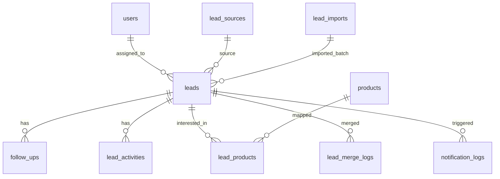

# Phase 1: Sales CRM Core, Excel Import & Follow-ups

> **Status:** ✅ Completed & Verified
> **Target Timeline:** Weeks 2–5
> **Key Goal:** Give the sales team a complete platform to capture leads via multiple channels, run chained follow-ups, auto-assign leads with intelligence, track conversion pipelines, and never miss an opportunity — with WhatsApp notifications and lead intelligence baked in.

---

## 1. Scope & Features

### 1.1 Lead Management (Core)
- Full CRUD for leads: name, phone, alt_phone, email, company, city, source, priority (Hot/Warm/Cold), budget, tags, notes.
- **Lead Status Pipeline:** `New → Contacted → Interested → Demo/Meeting → Proposal → Negotiation → Won / Lost`
- Lost requires mandatory reason: `Price | No Response | Competitor | Not Needed | Wrong Number | Other`
- Status change creates automatic timeline entry.
- **Soft delete** with restore option for admins.

### 1.2 Lead Capture Channels

| Channel | How |
|---|---|
| **Manual Entry** | Form-based single lead creation |
| **Excel Import Wizard** | Upload `.xlsx`/`.csv`, map columns, deduplicate, queue background job |
| **Email-to-Lead** | Magic inbox address — forwarded email auto-creates a lead from sender data |
| **API / Webhook** | `POST /api/v1/leads/inbound` with API key — used by website forms, Meta Lead Ads, Google Ads |

### 1.3 Excel Import Wizard (5-step flow)

```
Step 1: Upload .xlsx / .csv
Step 2: Column Mapping screen
        (Name, Phone, Email, Company, Budget, Source, Priority)
Step 3: Validation Preview
        (invalid phone = red, empty name = warning, sample rows shown)
Step 4: Duplicate Rules
        - Check by: phone / email / both
        - Action: Skip | Update existing | Add anyway (mark as duplicate)
Step 5: Assignment Rule
        - Specific agent / Round-robin / Product-wise / Load-balanced
        → Background Queue job dispatched
        → Summary: 200 imported, 12 duplicates, 5 errors (error CSV download)
```

Package: `maatwebsite/excel` + Laravel Queue (Redis).

### 1.4 Lead Intelligence & Scoring
- **Activity score** auto-recalculates a `score` (0–100) on each interaction:
  - Follow-up done (+5), Missed follow-up (−3), Status upgrade (+10), Stale 7 days (−5/day up to −30)
- Score drives priority recommendation (Hot/Warm/Cold).
- Displayed as a badge on lead cards.
- **Behaviour tags**: Configurable by admin. E.g. "Price Sensitive", "Decision Maker", "Urgent".
- **Lead merge**: When duplicates are found after import, team can merge two leads — combined timeline, oldest ID retained.

### 1.5 Auto-Assignment Engine

| Strategy | Logic |
|---|---|
| **Round-robin** | Agents get equal share in rotating order |
| **Product-wise** | Software leads → Software agents, Ads leads → Ads team |
| **Load-balanced** | Assign to agent with fewest open active leads |
| **Manual** | Manager/Admin picks assignee |

### 1.6 Chained Follow-up Engine
- Multiple follow-ups per lead, each as its own row.
- Types: `Call | WhatsApp | Email | Meeting`
- **Mandatory Next Follow-up Rule**: Marking "Done" prompts for next follow-up until lead is Won/Lost.
- Follow-up outcome notes are required when marking Done.

### 1.7 Alerts & Scheduled Notifications

| Alert | Channel | Trigger |
|---|---|---|
| Today's follow-ups card | Dashboard top | Agent login |
| Overdue follow-ups (red) | Dashboard + badge | Real-time |
| 15-min reminder | In-app + WhatsApp | Before scheduled time |
| Daily digest (9:00 AM) | Email + WhatsApp | Scheduler |
| Missed 24h escalation | In-app + email to Manager | Scheduler |
| Stale lead (7 days) | In-app notification | Scheduler |

**WhatsApp Notification Layer** (via Meta Cloud API / Twilio):
- Send approved template messages for reminders, overdue alerts, daily digest.
- All outbound messages logged in `notification_logs` table.
- Abstracted behind `NotificationChannelServiceInterface` — email/push/WhatsApp swappable.

### 1.8 Timeline & Activity Log
Chronological feed per lead:
```
📥 Imported from Excel batch #12 (Admin)          10 Sep, 10:00
👤 Auto-assigned to Rahul (round-robin)           10 Sep, 10:01
📞 Call done: "Interested, wants demo"            11 Sep, 12:30
📅 Follow-up scheduled: 14 Sep 4:00 PM           11 Sep, 12:31
🔄 Status: Contacted → Interested                 11 Sep, 12:31
📝 Note added: "Budget ₹80k"                     12 Sep, 09:10
⭐ Score: 42 → 52 (follow-up completed)           12 Sep, 09:11
🔁 Reassigned: Rahul → Priya                      15 Sep, 11:00
🏆 Status: Won                                    20 Sep, 16:00
```

---

## 2. Database Schema (Phase 1)



### 2.1 Table: `lead_sources`
| Column | Type | Attributes | Description |
|---|---|---|---|
| `id` | BIGINT UNSIGNED | PK, Auto-increment | |
| `name` | VARCHAR(100) | Unique | Meta, Google Ads, Referral, Website, Cold Outreach |
| `is_active` | BOOLEAN | Default: true | |
| `timestamps` | TIMESTAMP | Nullable | |

### 2.2 Table: `products`
| Column | Type | Attributes | Description |
|---|---|---|---|
| `id` | BIGINT UNSIGNED | PK, Auto-increment | |
| `name` | VARCHAR(150) | Unique | Custom Software, Google Ads, SEO, Mobile CRM |
| `type` | ENUM | 'software', 'service', 'product' | Determines downstream track |
| `price_range` | VARCHAR(100) | Nullable | e.g. ₹50,000 – ₹2,00,000 |
| `is_active` | BOOLEAN | Default: true | |
| `timestamps` | TIMESTAMP | Nullable | |

### 2.3 Table: `leads`
| Column | Type | Attributes | Description |
|---|---|---|---|
| `id` | BIGINT UNSIGNED | PK, Auto-increment | |
| `name` | VARCHAR(255) | Indexed | Contact person name |
| `phone` | VARCHAR(50) | Indexed | Primary contact number |
| `alt_phone` | VARCHAR(50) | Nullable | Alternate number |
| `email` | VARCHAR(255) | Nullable, Indexed | Email address |
| `company` | VARCHAR(255) | Nullable | Business or company name |
| `city` | VARCHAR(100) | Nullable | City location |
| `source_id` | BIGINT UNSIGNED | FK → lead_sources.id | |
| `priority` | ENUM | 'hot', 'warm', 'cold' | Default: 'warm' |
| `status` | ENUM | 'new', 'contacted', 'interested', 'demo_meeting', 'proposal', 'negotiation', 'won', 'lost' | Default: 'new' |
| `score` | SMALLINT UNSIGNED | Default: 0 | 0–100 activity-based intelligence score |
| `budget` | DECIMAL(12,2) | Default: 0 | Estimated deal value |
| `lost_reason` | VARCHAR(255) | Nullable | Required if status == 'lost' |
| `lost_notes` | TEXT | Nullable | Detailed reason |
| `assigned_to` | BIGINT UNSIGNED | Nullable, FK → users.id | Sales agent |
| `converted_client_id` | BIGINT UNSIGNED | Nullable | Linked client if won |
| `import_id` | BIGINT UNSIGNED | Nullable, FK → lead_imports.id | |
| `master_lead_id` | BIGINT UNSIGNED | Nullable, FK → leads.id | Set if this lead was merged into another |
| `last_activity_at` | DATETIME | Nullable | For stale detection |
| `created_by` | BIGINT UNSIGNED | Nullable, FK → users.id | |
| `timestamps` | TIMESTAMP | Nullable | |
| `deleted_at` | TIMESTAMP | Nullable | Soft deletes |

### 2.4 Table: `follow_ups`
| Column | Type | Attributes | Description |
|---|---|---|---|
| `id` | BIGINT UNSIGNED | PK, Auto-increment | |
| `lead_id` | BIGINT UNSIGNED | FK → leads.id, Cascade | |
| `agent_id` | BIGINT UNSIGNED | FK → users.id | Follow-up assignee |
| `type` | ENUM | 'call', 'whatsapp', 'email', 'meeting' | |
| `scheduled_at` | DATETIME | Indexed | Planned date & time |
| `status` | ENUM | 'pending', 'done', 'missed', 'rescheduled' | Default: 'pending' |
| `outcome` | TEXT | Nullable | Notes of the discussion |
| `completed_at` | DATETIME | Nullable | Actual completion time |
| `next_follow_up_id` | BIGINT UNSIGNED | Nullable, FK → follow_ups.id | Chained reference |
| `timestamps` | TIMESTAMP | Nullable | |

### 2.5 Table: `lead_activities`
| Column | Type | Attributes | Description |
|---|---|---|---|
| `id` | BIGINT UNSIGNED | PK, Auto-increment | |
| `lead_id` | BIGINT UNSIGNED | FK → leads.id, Cascade | |
| `user_id` | BIGINT UNSIGNED | Nullable, FK → users.id | Actor |
| `type` | VARCHAR(50) | Indexed | 'created', 'assigned', 'status_change', 'follow_up', 'note', 'score_change', 'merged' |
| `payload` | JSON | Nullable | Old/new values, remarks |
| `created_at` | TIMESTAMP | Indexed | |

### 2.6 Table: `notification_logs`
| Column | Type | Attributes | Description |
|---|---|---|---|
| `id` | BIGINT UNSIGNED | PK, Auto-increment | |
| `notifiable_type` | VARCHAR(255) | | Polymorphic model class |
| `notifiable_id` | BIGINT UNSIGNED | | Target user |
| `channel` | ENUM | 'email', 'whatsapp', 'database', 'push' | Delivery channel used |
| `type` | VARCHAR(100) | | 'follow_up_reminder', 'daily_digest', 'escalation' |
| `payload` | JSON | | Message data, lead_id, etc. |
| `status` | ENUM | 'sent', 'failed', 'delivered' | |
| `sent_at` | DATETIME | | |
| `timestamps` | TIMESTAMP | | |

### 2.7 Table: `lead_merge_logs`
| Column | Type | Attributes | Description |
|---|---|---|---|
| `id` | BIGINT UNSIGNED | PK, Auto-increment | |
| `master_lead_id` | BIGINT UNSIGNED | FK → leads.id | Retained lead |
| `merged_lead_id` | BIGINT UNSIGNED | | Archived/deleted lead ID |
| `merged_by` | BIGINT UNSIGNED | FK → users.id | Admin who merged |
| `merged_data_snapshot` | JSON | | Full snapshot of merged lead before deletion |
| `timestamps` | TIMESTAMP | | |

---

## 3. Backend Architecture & Contracts

### 3.1 Service Interfaces

**`App\Contracts\Services\LeadServiceInterface`**
- `getPaginatedLeads(array $filters, int $perPage): LengthAwarePaginator`
- `createLead(array $data): Lead`
- `updateLead(Lead $lead, array $data): Lead`
- `changeStatus(Lead $lead, string $status, ?string $reason): Lead`
- `assignLead(Lead $lead, int $agentId): Lead`
- `mergeLead(Lead $master, Lead $duplicate, User $actor): Lead`
- `recalculateScore(Lead $lead): Lead`
- `bulkAssign(array $leadIds, int $agentId, User $actor): int`
- `bulkChangeStatus(array $leadIds, string $status, User $actor): int`

**`App\Contracts\Services\FollowUpServiceInterface`**
- `getTodayFollowUps(int $agentId): Collection`
- `getOverdueFollowUps(int $agentId): Collection`
- `scheduleFollowUp(array $data): FollowUp`
- `completeFollowUp(FollowUp $followUp, array $outcomeData): FollowUp`

**`App\Contracts\Services\LeadImportServiceInterface`**
- `validateAndPreview(UploadedFile $file): array`
- `queueImport(int $importId, array $columnMapping, string $duplicateStrategy, ?int $assignedAgentId): void`

**`App\Contracts\Services\NotificationChannelServiceInterface`**
- `send(User $user, string $type, array $data, string $channel = 'auto'): void`
  - 'auto' = picks preferred channel based on user settings (email/whatsapp/push)

### 3.2 Lead Score Calculation

```php
// app/Actions/Leads/RecalculateLeadScoreAction.php
class RecalculateLeadScoreAction
{
    public function execute(Lead $lead): int
    {
        $score = 0;
        $score += $lead->follow_ups()->where('status', 'done')->count() * 5;
        $score -= $lead->follow_ups()->where('status', 'missed')->count() * 3;
        $score += $this->statusScore($lead->status); // New=0, Contacted=10, Won=100
        $staleDays = now()->diffInDays($lead->last_activity_at ?? $lead->created_at);
        if ($staleDays >= 7) $score -= min($staleDays * 2, 30);
        return max(0, min(100, $score));
    }
}
```

### 3.3 Scheduled Commands

```php
// routes/console.php

// Hourly: check missed follow-ups, escalate to Sales Manager if >24h
Schedule::command('followups:check-overdue')->hourly();

// 9:00 AM: Daily digest via email + WhatsApp to all agents
Schedule::command('followups:send-daily-digest')->dailyAt('09:00');

// Flag stale leads (no contact in 7 days)
Schedule::command('leads:flag-stale')->dailyAt('00:30');

// Nightly: recalculate all lead scores
Schedule::command('leads:recalculate-scores')->dailyAt('01:00');
```

### 3.4 Email-to-Lead Pipeline

```
Incoming email → Mailgun Inbound Routes
    → POST /api/v1/leads/email-inbound (signed webhook)
    → Parse: sender name, email, subject (as notes), body snippet
    → Create lead with source = 'email_inbound'
    → Auto-assign via round-robin
    → Notify assigned agent (in-app + WhatsApp)
```

---

## 4. API Endpoints

| Method | Endpoint | Description | Auth |
|---|---|---|---|
| `GET` | `/api/v1/leads` | List leads (filters: status, agent, priority, source, date) | Sanctum |
| `POST` | `/api/v1/leads` | Create manual lead | Sanctum |
| `GET` | `/api/v1/leads/{id}` | Lead profile + details | Sanctum |
| `PUT` | `/api/v1/leads/{id}` | Update lead details | Sanctum |
| `DELETE` | `/api/v1/leads/{id}` | Soft delete lead | Sanctum (Manager+) |
| `PATCH` | `/api/v1/leads/{id}/status` | Stage transition + lost reason | Sanctum |
| `POST` | `/api/v1/leads/{id}/assign` | Reassign lead to another agent | Sanctum (Manager+) |
| `GET` | `/api/v1/leads/{id}/timeline` | Chronological activity feed | Sanctum |
| `POST` | `/api/v1/leads/bulk-assign` | Bulk reassign selected leads | Sanctum (Manager+) |
| `POST` | `/api/v1/leads/bulk-status` | Bulk stage change | Sanctum (Manager+) |
| `POST` | `/api/v1/leads/{id}/merge` | Merge duplicate into master | Sanctum (Manager+) |
| `GET` | `/api/v1/follow-ups/today` | Today's pending follow-ups | Sanctum |
| `GET` | `/api/v1/follow-ups/overdue` | Overdue alert items | Sanctum |
| `POST` | `/api/v1/leads/{id}/follow-ups` | Schedule new follow-up | Sanctum |
| `PATCH` | `/api/v1/follow-ups/{id}/complete` | Mark done + chain next follow-up | Sanctum |
| `POST` | `/api/v1/leads/import/preview` | Upload spreadsheet → column mapping | Sanctum |
| `POST` | `/api/v1/leads/import/process` | Dispatch background import job | Sanctum |
| `GET` | `/api/v1/leads/import/{id}/status` | Poll import job progress | Sanctum |
| `POST` | `/api/v1/leads/inbound` | Webhook: website form / Meta Ads / Email-to-Lead | API Key |

---

## 5. Frontend Deliverables

### 5.1 Sales Agent Dashboard
- **Hero cards**: Today's follow-ups (count + list preview), Overdue (red badge), My leads this month, My won this month.
- Quick actions: "Add Lead", "Start Follow-up", "View All Overdue".
- Real-time notification bell with unread badge.

### 5.2 Leads List Page
- Advanced multi-filter bar: status, priority, product, source, assigned agent, city, date range.
- Global search (name, phone, email, company).
- **Bulk select** with floating action bar: Assign, Change Status, Add Tag, Export Selected.
- Column toggle: show/hide score, budget, last activity.
- Export as Excel/CSV (filtered results).

### 5.3 Kanban Board
- 8 columns: New, Contacted, Interested, Demo/Meeting, Proposal, Negotiation, Won, Lost.
- Cards show: name, priority badge, score, last follow-up date, assigned agent avatar.
- Drag-and-drop (dnd-kit) with optimistic UI updates; rollback on API error.
- Dropping into Lost → mandatory reason dialog.

### 5.4 Lead Detail Page
- Left panel: Full profile, edit in place, tag selector, product tags.
- Right panel: Tabs — Timeline | Follow-ups | Notes | AI Suggestions.
- **AI Suggestions tab**: "3 days since last contact — schedule a call", "Similar leads in this stage won with a demo".
- **Convert button**: Visible when status is Won.

### 5.5 Excel Import Wizard (5-step stepper)
- Step 1: Drag-and-drop file upload with format/size validation.
- Step 2: Column mapper — auto-detect common headers, manual override.
- Step 3: Validation preview — row-level error/warning indicators.
- Step 4: Duplicate rules + assignment selector.
- Step 5: Confirmation + live progress tracker (polling import status) + summary card.

### 5.6 Lead Merge Modal
- Side-by-side comparison of both leads.
- Radio buttons to choose master record per field.
- Preview of merged timeline.
- "Merge" confirmation with audit log entry.

---

## 6. Definition of Done (Phase 1)

- [x] Migrations for `lead_sources`, `products`, `leads`, `follow_ups`, `lead_activities`, `lead_imports`, `notification_logs`, `lead_merge_logs` executed successfully.
- [x] Excel/CSV import parser and deduplication engine implemented with preview and error logging.
- [x] Duplicate detection (phone + email match) tested: Skip, Update, Add scenarios all pass.
- [x] Chained follow-up engine implemented and tested (mandatory outcome + chained next follow-up).
- [x] 8-Stage Kanban board & multi-filter table view with bulk select and reassignment.
- [x] Lead merge tested: combined timeline correct, duplicate marked as merged and soft-deleted.
- [x] Lead score recalculation tested: score changes reflected on activity, badge updates.
- [x] Feature tests for all Lead, Follow-up, and Import endpoints: 100% assertions passing (12 tests, 90 assertions).
- [x] Cross-agent data isolation tests: agent cannot view another agent's leads.
- [x] Slide-over Lead Profile Drawer with activity timeline, follow-up scheduler, and in-place details.
