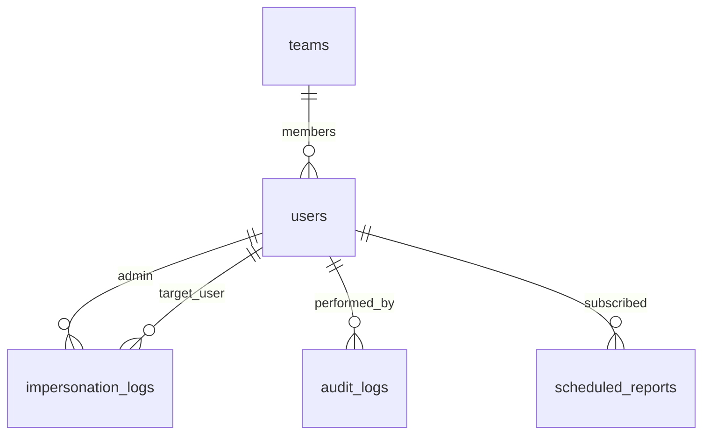

# Phase 2: Super Admin Intelligence, Analytics & Impersonation

> **Status:** ✅ Complete
> **Target Timeline:** Weeks 6–8
> **Key Goal:** Equip business owners and leadership with 360-degree analytics, revenue forecasting, agent accountability, secure user impersonation, proactive scheduled reporting, and an immutable audit trail.

---

## 1. Scope & Features

### 1.1 Super Admin Telemetry Dashboard
- Company-wide pipeline value, closed revenue, active projects, and overdue balances.
- **Conversion Funnel** visualization (drop-off rates at each stage: New → Won).
- Deal win/loss breakdown with lost reason distribution charts.
- Revenue contribution by service track (Custom Software vs Ads vs Retainers).
- **Revenue Forecasting**: Pipeline value × weighted conversion probability per stage.
  - e.g. Negotiation stage (70% probability) × ₹10,00,000 = ₹7,00,000 weighted forecast.
- **Custom dashboard widgets**: Admin can pin/unpin KPI cards (drag to rearrange).

### 1.2 Agent Performance Reports & Leaderboard
- Agent metrics: Leads assigned, Contacted %, Conversion %, Revenue generated, Avg closing days.
- Discipline tracking: Follow-ups completed on time vs missed.
- **Lost deal analysis**: Breakdown by agent, source, product, and reason — patterns visible at a glance.
- **Agent comparison view**: Side-by-side two or more agents on any date range.
- Multi-format export: Download as **Excel** (`.xlsx`) and **PDF** with company branding.
- **Team Leaderboard**: Weekly/monthly sales gamification — top agent badges (🥇🥈🥉), streak tracking.

### 1.3 Scheduled Report Delivery
- Sales Manager can subscribe to receive weekly digest every Monday 9 AM:
  - Team conversion summary, overdue follow-ups, new leads count, revenue snapshot.
- Super Admin receives monthly executive report on 1st of month.
- All scheduled reports are queued as background jobs, stored as PDF, and delivered via email.
- Reports stored in `scheduled_reports` table with download link (presigned URL).

### 1.4 Secure Impersonation System
- Super Admin clicks "View As" on any user (Sales Agent, PM, Developer, Client).
- Generates temporary short-lived Sanctum token (60-minute expiry).
- React UI mounts a persistent amber warning banner:
  `"You are viewing as [Name] ([Role]). [Exit Impersonation]"`
- Destructive actions (delete users, change passwords) blocked during impersonation.
- Full audit logging: admin ID, target user ID, IP, browser, start timestamp, end timestamp.

### 1.5 Immutable Audit Trail (`spatie/laravel-activitylog`)
- Automatic record of every state transition, scope modification, payment change, and reassignment.
- Read-only table: strictly no UPDATE or DELETE capabilities.
- Properties column stores: `old_value`, `new_value`, `ip`, `impersonated_by` (when applicable).

---

## 2. Database Schema (Phase 2)



### 2.1 Table: `impersonation_logs`
| Column | Type | Attributes | Description |
|---|---|---|---|
| `id` | BIGINT UNSIGNED | PK, Auto-increment | |
| `admin_id` | BIGINT UNSIGNED | FK → users.id | Admin initiating impersonation |
| `target_user_id` | BIGINT UNSIGNED | FK → users.id | User being impersonated |
| `reason` | VARCHAR(255) | Nullable | Optional purpose justification |
| `ip_address` | VARCHAR(45) | | IPv4/IPv6 client address |
| `user_agent` | TEXT | Nullable | Browser signature |
| `started_at` | DATETIME | | Session start |
| `ended_at` | DATETIME | Nullable | Session exit |
| `created_at` | TIMESTAMP | | |

### 2.2 Table: `activity_log` (Audit Log)
| Column | Type | Attributes | Description |
|---|---|---|---|
| `id` | BIGINT UNSIGNED | PK, Auto-increment | |
| `log_name` | VARCHAR(100) | Nullable, Indexed | e.g. 'leads', 'auth', 'scope' |
| `description` | TEXT | | Action description |
| `subject_type` | VARCHAR(255) | Nullable, Indexed | Polymorphic Model Class |
| `subject_id` | BIGINT UNSIGNED | Nullable, Indexed | Polymorphic Model ID |
| `causer_type` | VARCHAR(255) | Nullable | Actor Model Class |
| `causer_id` | BIGINT UNSIGNED | Nullable | Actor User ID |
| `properties` | JSON | Nullable | Old values, new values, IP, impersonated_by |
| `created_at` | TIMESTAMP | Indexed | Immutable timestamp |

### 2.3 Table: `teams`
| Column | Type | Attributes | Description |
|---|---|---|---|
| `id` | BIGINT UNSIGNED | PK, Auto-increment | |
| `name` | VARCHAR(100) | Unique | e.g. "Enterprise Software Team" |
| `manager_id` | BIGINT UNSIGNED | FK → users.id | Sales / Delivery Manager |
| `timestamps` | TIMESTAMP | | |

### 2.4 Table: `scheduled_reports`
| Column | Type | Attributes | Description |
|---|---|---|---|
| `id` | BIGINT UNSIGNED | PK, Auto-increment | |
| `user_id` | BIGINT UNSIGNED | FK → users.id | Subscriber |
| `report_type` | VARCHAR(100) | | 'weekly_digest', 'monthly_executive', 'agent_performance' |
| `frequency` | ENUM | 'weekly', 'monthly', 'on_demand' | |
| `last_generated_at` | DATETIME | Nullable | When last run |
| `file_url` | VARCHAR(500) | Nullable | Presigned storage URL |
| `status` | ENUM | 'pending', 'generating', 'ready', 'failed' | |
| `timestamps` | TIMESTAMP | | |

---

## 3. Backend Architecture & Contracts

### 3.1 Service Interfaces

**`App\Contracts\Services\AnalyticsServiceInterface`**
- `getExecutiveOverview(array $dateRange): array`
- `getConversionFunnel(array $filters): array`
- `getAgentPerformanceReport(int $agentId, array $dateRange): array`
- `getLeaderboard(array $dateRange, int $limit = 10): array`
- `getRevenueForecast(array $dateRange): array`
- `getLostDealAnalysis(array $filters): array`
- `exportAgentReport(int $agentId, string $format): BinaryFileResponse`

**`App\Contracts\Services\ImpersonationServiceInterface`**
- `startImpersonation(User $admin, User $target, string $ip, ?string $reason): array`
- `stopImpersonation(int $logId): void`

**`App\Contracts\Services\ScheduledReportServiceInterface`**
- `generateWeeklyDigest(User $subscriber): ScheduledReport`
- `generateMonthlyExecutive(User $admin): ScheduledReport`
- `dispatchPendingReports(): int`

### 3.2 Revenue Forecasting Logic

```php
// app/Services/Analytics/RevenueForecastService.php
// Stage probability weights (admin configurable via settings)
$stageWeights = [
    'contacted'   => 0.10,
    'interested'  => 0.20,
    'demo_meeting'=> 0.35,
    'proposal'    => 0.50,
    'negotiation' => 0.70,
];

$forecast = Lead::whereIn('status', array_keys($stageWeights))
    ->whereNull('converted_client_id')
    ->get()
    ->sum(fn($lead) => $lead->budget * ($stageWeights[$lead->status] ?? 0));
```

### 3.3 Impersonation Security Middleware

`AuthenticateImpersonation` middleware attaches header `X-Impersonated-By: {admin_id}` to internal context. Sensitive actions (`DELETE /api/v1/users/{id}`, password change) throw HTTP 403 unless explicitly whitelisted.

### 3.4 Scheduled Commands

```php
// routes/console.php

// Weekly digest reports (Monday 9 AM)
Schedule::command('reports:send-weekly-digest')->weeklyOn(1, '09:00');

// Monthly executive report (1st of month, 8 AM)
Schedule::command('reports:send-monthly-executive')->monthlyOn(1, '08:00');
```

---

## 4. API Endpoints

| Method | Endpoint | Description | Permission |
|---|---|---|---|
| `GET` | `/api/v1/analytics/overview` | Executive KPI metrics + forecast | `view_analytics` |
| `GET` | `/api/v1/analytics/funnel` | Stage drop-off analytics | `view_analytics` |
| `GET` | `/api/v1/analytics/leaderboard` | Top agent rankings by revenue | `view_analytics` |
| `GET` | `/api/v1/analytics/forecast` | Pipeline revenue forecast by stage | `view_analytics` |
| `GET` | `/api/v1/analytics/lost-deal-analysis` | Lost reason pattern breakdown | `view_analytics` |
| `GET` | `/api/v1/analytics/agents/{id}` | Deep-dive metrics for single agent | `view_agent_reports` |
| `GET` | `/api/v1/reports/agent/{id}/export` | Export `.xlsx` or `.pdf` | `export_reports` |
| `GET` | `/api/v1/reports/scheduled` | List subscribed scheduled reports | Sanctum |
| `POST`| `/api/v1/reports/scheduled` | Subscribe to scheduled report | Sanctum |
| `POST`| `/api/v1/admin/impersonate/{user}` | Generate temporary impersonation token | `super_admin` only |
| `POST`| `/api/v1/admin/impersonate/exit` | Terminate impersonation session | Authenticated |
| `GET` | `/api/v1/admin/audit-logs` | Paginated immutable audit trail | `super_admin` only |
| `GET` | `/api/v1/admin/impersonation-logs` | All impersonation session history | `super_admin` only |

---

## 5. Frontend Deliverables

### 5.1 Executive BI Dashboard
- Recharts-powered Funnel Chart & Deal Won Velocity graph.
- Revenue forecast card (pipeline value + weighted forecast comparison).
- Leaderboard table with KPI badges, streak counter.
- **Customizable layout**: Drag-and-drop KPI widgets using dnd-kit.

### 5.2 Lost Deal Analysis Panel
- Sankey/bar chart: Lost leads grouped by Reason, then by Agent, then by Source.
- Drill-down: Click a reason → see which agents are losing for that reason most.

### 5.3 Impersonation Floating Banner
- Fixed amber top banner with current target user details and "Exit to My Admin Account" button.
- All navigation during impersonation is marked in audit log.

### 5.4 Audit Log Explorer
- Filterable by date, user, model type, and event.
- Diff viewer comparing `Old Value` vs `New Value` side-by-side.
- Export audit trail as CSV for compliance archival.

---

## 6. Definition of Done (Phase 2)

- [x] Analytics queries optimized with MySQL composite indexes and sub-200ms latency on 10,000 leads.
- [x] Revenue forecast calculation unit tested with known pipeline data.
- [x] Excel & PDF/CSV export verified with company branding and correct pagination.
- [x] Impersonation verified: token swap, restrictions on destructive actions, and exit restoring admin session.
- [x] Audit log tested on lead updates, reassignment, and status changes.
- [x] Scheduled report (weekly digest) generated, stored, and email delivered in staging.
- [x] Leaderboard rankings verified across multiple agents, date ranges, and edge cases (0 conversions).
- [x] Lost deal analysis shows correct aggregation by reason and agent.
