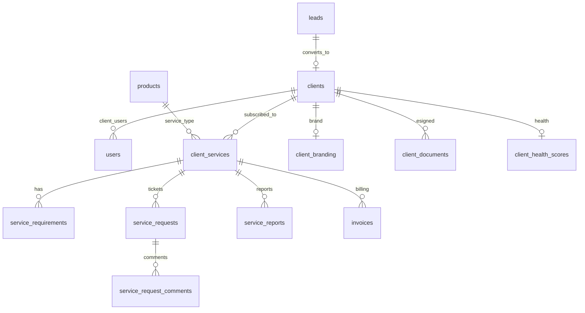

# Phase 3: Won → Client Auto-Conversion, Service Track & White-label Portal

> **Status:** 📋 Documented
> **Target Timeline:** Weeks 9–12
> **Key Goal:** Automatically convert won sales leads into client accounts with zero manual re-entry. Provide a lightweight Service Track for recurring services with a white-label client portal experience including guided onboarding, e-sign capabilities, retainer billing, and client health scoring.

---

## 1. Scope & Features

### 1.1 Won → Client Conversion Wizard
- Single-click transition when a lead is marked `won`.
- Pre-fills all known contact details from the lead history.
- Select multiple services:
  - **Custom Software** → Automatically creates a Project in `draft` state.
  - **Recurring Retainer / Google Ads / Pre-built SaaS** → Creates a `client_service` subscription.
- Generates client user credentials and emails an invitation with a secure password-set link.
- Pre-sales timeline (calls, notes, negotiations) remains attached under "Sales History" in client profile so PMs know what was promised.

### 1.2 Client Onboarding Checklist (First Login)
- On first login, client sees a guided checklist:
  1. Complete your profile (photo, billing address, GST)
  2. Review your active services
  3. Submit your first requirement / ticket
  4. Review your welcome document (uploaded by AM)
  5. (If software project) Approve the scope when ready
- Progress bar visible. Admin can see which clients have completed onboarding.
- After 100% completion, checklist collapses to a "Help" tab.

### 1.3 White-label Client Portal
- **Custom domain**: Each client's portal can be accessed at `client-company.yourplatform.com`.
  - Handled via wildcard CNAME (`*.yourplatform.com`) + dynamic tenant resolution.
- **Brand customization per client**: Upload company logo, set primary brand color.
  - Stored in `client_branding` table, injected at runtime as CSS variables.
- Platform vendor name/logo hidden from client portal by default.
- Feature toggles per client: hide/show specific modules (e.g. hide GitHub for non-software clients).

### 1.4 Contract & Proposal E-signing
- PM or Admin uploads a contract PDF / HTML proposal.
- Client receives notification and is presented an inline signing experience (DocuSign-style).
- Client draws/types signature + submits with IP, timestamp, and device fingerprint recorded.
- Signed document stored as PDF snapshot in S3/R2.
- Stored in `client_documents` table with `signed_at`, `ip`, `signature_data_url`.
- **Legal-grade**: signature event is immutable and audit logged.

### 1.5 Service Track (Lightweight Service Management)
For retainers, Google Ads management, SEO, and small pre-built product tweaks.
- **Requirement Submission**: Client or Account Manager can fill requirements.
- **Source Attribution**: Every requirement and ticket tagged: `Added by: Client` or `Added by: Admin (on behalf of client)`.
- **Ticket Lifecycle**: `Open → In Progress → Done → Client Confirmed`.
- **Monthly Reports**: Direct upload of PDF/metrics (Ad spend, CPC, leads generated).
- **Escalation Path**: Any ticket that expands in complexity can be converted to a full Software Project with 1 click.

### 1.6 Retainer Billing (Auto-recurring Invoices)
- For monthly/quarterly recurring services, invoices are auto-generated by scheduler.
- Admin sets: service start date, billing cycle (monthly/quarterly/yearly), amount.
- Scheduler generates invoice N days before billing date (configurable, default 7 days).
- Client receives email + in-portal notification for each invoice.
- Supports: full payment, partial payment (multi-installment), and manual "mark as paid" + receipt upload.
- GST-compliant invoice format (CGST/SGST/IGST line items based on state).

### 1.7 Client Health Score
Auto-calculated composite score (0–100) for each client based on:

| Signal | Weight | Description |
|---|---|---|
| Open ticket age | 30% | Older unresolved tickets = lower health |
| Payment timeliness | 25% | Overdue invoices lower score |
| Portal engagement | 20% | How recently client logged in, confirmed tasks |
| Feedback given | 15% | Clients who provide feedback are more engaged |
| Communication response | 10% | Response time on MoM confirmations, CR decisions |

- Displayed on client list as 🟢 Healthy / 🟡 At Risk / 🔴 Churning badge.
- Admin gets weekly "At Risk Clients" alert for health scores below 40.

---

## 2. Database Schema (Phase 3)



### 2.1 Table: `clients`
| Column | Type | Attributes | Description |
|---|---|---|---|
| `id` | BIGINT UNSIGNED | PK, Auto-increment | |
| `name` | VARCHAR(255) | | Client / Point of contact name |
| `company` | VARCHAR(255) | Nullable | Organization name |
| `email` | VARCHAR(255) | Unique | Primary billing/admin email |
| `phone` | VARCHAR(50) | Indexed | Contact number |
| `gst_number` | VARCHAR(50) | Nullable | Tax / GST identification |
| `billing_address` | TEXT | Nullable | Address for invoices |
| `billing_state` | VARCHAR(100) | Nullable | For GST (CGST/SGST vs IGST logic) |
| `source_lead_id` | BIGINT UNSIGNED | Nullable, FK → leads.id | Historical link |
| `account_manager_id` | BIGINT UNSIGNED | Nullable, FK → users.id | Support / AM |
| `onboarding_completed` | BOOLEAN | Default: false | First login checklist finished |
| `status` | ENUM | 'active', 'inactive', 'suspended' | Default: 'active' |
| `timestamps` | TIMESTAMP | | |

### 2.2 Table: `client_branding`
| Column | Type | Attributes | Description |
|---|---|---|---|
| `id` | BIGINT UNSIGNED | PK, Auto-increment | |
| `client_id` | BIGINT UNSIGNED | Unique, FK → clients.id | |
| `logo_url` | VARCHAR(500) | Nullable | S3/R2 URL |
| `primary_color` | VARCHAR(7) | Nullable | Hex color e.g. '#1E40AF' |
| `subdomain` | VARCHAR(100) | Unique, Nullable | e.g. 'acmecorp' → acmecorp.crm.com |
| `custom_domain` | VARCHAR(255) | Unique, Nullable | e.g. 'portal.acmecorp.com' |
| `hide_vendor_branding` | BOOLEAN | Default: true | |
| `enabled_features` | JSON | Nullable | Feature flags per client |
| `timestamps` | TIMESTAMP | | |

### 2.3 Table: `client_documents`
| Column | Type | Attributes | Description |
|---|---|---|---|
| `id` | BIGINT UNSIGNED | PK, Auto-increment | |
| `client_id` | BIGINT UNSIGNED | FK → clients.id | |
| `type` | VARCHAR(100) | | 'contract', 'proposal', 'nda', 'welcome' |
| `title` | VARCHAR(255) | | Document title |
| `file_url` | VARCHAR(500) | | Original document URL |
| `signed_file_url` | VARCHAR(500) | Nullable | Signed version URL |
| `status` | ENUM | 'pending_signature', 'signed', 'declined', 'expired' | |
| `signed_at` | DATETIME | Nullable | |
| `signer_ip` | VARCHAR(45) | Nullable | |
| `signer_name` | VARCHAR(255) | Nullable | Typed signature name |
| `signature_data_url` | TEXT | Nullable | Base64 drawn signature image |
| `uploaded_by` | BIGINT UNSIGNED | FK → users.id | |
| `timestamps` | TIMESTAMP | | |

### 2.4 Table: `client_services`
| Column | Type | Attributes | Description |
|---|---|---|---|
| `id` | BIGINT UNSIGNED | PK, Auto-increment | |
| `client_id` | BIGINT UNSIGNED | FK → clients.id, Cascade | |
| `product_id` | BIGINT UNSIGNED | FK → products.id | Service item |
| `service_type` | ENUM | 'recurring', 'one_time', 'software_project' | |
| `status` | ENUM | 'active', 'in_progress', 'paused', 'completed' | Default: 'active' |
| `start_date` | DATE | | Contract commencement |
| `billing_cycle` | ENUM | 'monthly', 'quarterly', 'yearly', 'milestone' | |
| `value` | DECIMAL(12,2) | | Contract value / recurring fee |
| `next_invoice_date` | DATE | Nullable | Auto-set by scheduler |
| `timestamps` | TIMESTAMP | | |

### 2.5 Table: `service_requests` (Tickets)
| Column | Type | Attributes | Description |
|---|---|---|---|
| `id` | BIGINT UNSIGNED | PK, Auto-increment | |
| `client_service_id` | BIGINT UNSIGNED | FK → client_services.id | |
| `ticket_number` | VARCHAR(50) | Unique | e.g. `TICK-2026-0042` |
| `title` | VARCHAR(255) | | Request subject |
| `description` | TEXT | | Details |
| `priority` | ENUM | 'low', 'medium', 'high', 'urgent' | Default: 'medium' |
| `status` | ENUM | 'open', 'in_progress', 'done', 'confirmed', 'closed' | Default: 'open' |
| `added_by` | BIGINT UNSIGNED | FK → users.id | Submitter |
| `added_by_type` | ENUM | 'client', 'admin' | |
| `assigned_to` | BIGINT UNSIGNED | Nullable, FK → users.id | Team member handling |
| `sla_deadline` | DATETIME | Nullable | SLA breach alert threshold |
| `completed_at` | DATETIME | Nullable | |
| `confirmed_at` | DATETIME | Nullable | Client verification |
| `timestamps` | TIMESTAMP | | |

### 2.6 Table: `client_health_scores`
| Column | Type | Attributes | Description |
|---|---|---|---|
| `id` | BIGINT UNSIGNED | PK, Auto-increment | |
| `client_id` | BIGINT UNSIGNED | Unique, FK → clients.id | |
| `score` | DECIMAL(5,2) | 0–100 | Composite health score |
| `ticket_score` | DECIMAL(5,2) | | Open ticket age component |
| `payment_score` | DECIMAL(5,2) | | Payment timeliness component |
| `engagement_score` | DECIMAL(5,2) | | Portal activity component |
| `feedback_score` | DECIMAL(5,2) | | Feedback participation component |
| `response_score` | DECIMAL(5,2) | | MoM/CR response time component |
| `status` | ENUM | 'healthy', 'at_risk', 'churning' | Computed label |
| `calculated_at` | DATETIME | | |
| `timestamps` | TIMESTAMP | | |

---

## 3. Backend Architecture & Contracts

### 3.1 Service Interfaces

**`App\Contracts\Services\ClientConversionServiceInterface`**
- `convertLead(Lead $lead, array $conversionPayload): Client`

**`App\Contracts\Services\ClientServiceInterface`**
- `getPaginatedClients(array $filters, int $perPage): LengthAwarePaginator`
- `getClientProfileWithHistory(int $clientId): Client`
- `getOnboardingProgress(Client $client): array`

**`App\Contracts\Services\ServiceTrackServiceInterface`**
- `createRequirement(int $serviceId, array $data, User $actor): ServiceRequirement`
- `createTicket(int $serviceId, array $data, User $actor): ServiceRequest`
- `transitionTicketStatus(ServiceRequest $ticket, string $status, User $actor): ServiceRequest`
- `uploadMonthlyReport(int $serviceId, UploadedFile $file, array $metrics): ServiceReport`
- `convertTicketToProject(ServiceRequest $ticket, array $projectMeta): Project`

**`App\Contracts\Services\ClientHealthScoreServiceInterface`**
- `calculateClientHealth(Client $client): ClientHealthScore`
- `recalculateAllClientsHealth(): int`
- `getAtRiskClients(int $threshold = 40): Collection`

**`App\Contracts\Services\RetainerBillingServiceInterface`**
- `generateInvoiceForService(ClientService $service): Invoice`
- `processDueBillingCycles(): int` (called by scheduler)

**`App\Contracts\Services\ESignServiceInterface`**
- `createDocument(Client $client, string $type, UploadedFile $file, User $uploader): ClientDocument`
- `signDocument(ClientDocument $document, array $signatureData, string $ip): ClientDocument`
- `generateSignedPdf(ClientDocument $document): string` (returns S3 URL)

### 3.2 Scheduled Commands

```php
// routes/console.php

// Daily: generate retainer invoices due in 7 days
Schedule::command('billing:generate-retainer-invoices')->dailyAt('07:00');

// Daily: recalculate all client health scores
Schedule::command('clients:recalculate-health')->dailyAt('02:00');

// Weekly Monday: alert admin on at-risk clients
Schedule::command('clients:send-at-risk-report')->weeklyOn(1, '09:30');
```

### 3.3 White-label Domain Resolution Middleware

```php
// app/Http/Middleware/ResolveTenantByDomain.php
// Runs before auth for client-portal routes
public function handle(Request $request, Closure $next)
{
    $host = $request->getHost();
    $branding = ClientBranding::where('custom_domain', $host)
        ->orWhere('subdomain', explode('.', $host)[0])
        ->firstOrFail();

    app()->instance('current_client_branding', $branding);
    return $next($request);
}
```

### 3.4 Events & Listeners
- Event: `App\Events\LeadWonEvent`
  - `SendClientWelcomeEmailListener` — invitation email with temp token
  - `NotifyProjectManagerListener` — alerts PM about new Software Project (Draft)
  - `InitializeOnboardingChecklistListener` — creates onboarding steps for new client

---

## 4. API Endpoints

| Method | Endpoint | Description | Auth |
|---|---|---|---|
| `POST` | `/api/v1/leads/{id}/convert` | Convert Won lead into client + services | Sanctum (Agent+) |
| `GET` | `/api/v1/clients` | List all active clients with health score | Sanctum |
| `GET` | `/api/v1/clients/{id}` | Client profile, services, sales history | Sanctum |
| `GET` | `/api/v1/clients/{id}/onboarding` | Get onboarding checklist progress | Sanctum |
| `PATCH` | `/api/v1/clients/{id}/onboarding/{step}` | Mark onboarding step complete | Sanctum |
| `GET` | `/api/v1/clients/{id}/health` | Client health score breakdown | Sanctum (Admin+) |
| `POST` | `/api/v1/clients/{id}/documents` | Upload document for e-sign | Sanctum (AM+) |
| `POST` | `/api/v1/documents/{id}/sign` | Client submits e-signature | Sanctum (Client) |
| `GET` | `/api/v1/services/{id}/tickets` | List tickets for a service | Sanctum |
| `POST` | `/api/v1/services/{id}/tickets` | Submit new ticket | Sanctum |
| `PATCH` | `/api/v1/tickets/{id}/status` | Transition ticket status | Sanctum |
| `POST` | `/api/v1/tickets/{id}/confirm` | Client confirms ticket done | Sanctum (Client) |
| `POST` | `/api/v1/tickets/{id}/convert-to-project` | Escalate ticket to Project | Sanctum (Admin+) |
| `POST` | `/api/v1/services/{id}/reports` | Upload monthly performance report | Sanctum (AM+) |
| `POST` | `/api/v1/services/{id}/invoices/generate` | Manually trigger retainer invoice | Sanctum (Admin+) |
| `PATCH` | `/api/v1/invoices/{id}/mark-paid` | Mark invoice as paid manually | Sanctum (Admin+) |

---

## 5. Frontend Deliverables

### 5.1 Conversion Wizard Modal
- Step 1: Pre-filled lead info review (all editable).
- Step 2: Multi-select services (Software vs Retainer vs One-time).
- Step 3: Deal value, billing cycle, and client invitation confirmation.

### 5.2 Client Onboarding Flow
- Welcome screen on first login with progress bar.
- Step-by-step checklist with animated completion states.
- Help tooltips explaining each section.

### 5.3 White-label Portal Branding
- Dynamic CSS variables injected from `client_branding` at page load.
- `<ClientBrandingProvider>` wraps the entire client portal app.
- Subdomain/custom domain detection in the frontend routing.

### 5.4 E-sign Document Viewer
- Inline PDF viewer (react-pdf) with designated signature zone highlighted.
- Canvas-based signature drawer OR type-your-name signature option.
- "Sign & Submit" button with confirmation modal showing legal notice.

### 5.5 Client Portal (Service Track View)
- Simple, non-technical dashboard showing subscribed services with status badges.
- "New Request" button with priority picker.
- Ticket timeline with clear status badges and "Confirm Completion" button.
- Monthly reports vault: downloadable PDF cards with quick telemetry preview.

### 5.6 Client Health Dashboard (Admin)
- Sortable client list with health score badge (🟢 / 🟡 / 🔴).
- Drill-down: click client → see health breakdown per component.
- Filter: "Show only At Risk" or "Show Churning".

---

## 6. Definition of Done (Phase 3)

- [ ] Conversion transaction rollback tested: if user invite creation fails, no orphan client committed.
- [ ] Converted client receives invite email and successfully sets password.
- [ ] Pre-sales timeline correctly rendered inside Client profile for PM review.
- [ ] Onboarding checklist displayed on first login, progresses correctly, collapses at 100%.
- [ ] White-label: custom domain resolves to correct client portal with brand color and logo.
- [ ] E-sign: document signed, PDF snapshot stored in S3, audit log entry created.
- [ ] Retainer invoice auto-generated by scheduler for due dates.
- [ ] GST invoice format verified (CGST/SGST vs IGST based on billing state).
- [ ] Client health score recalculation tested: score changes reflect open tickets, payment delays.
- [ ] Ticket lifecycle tested: Open → In Progress → Done → Client Confirmed.
- [ ] Service ticket escalation to Project tested.
- [ ] Feature-flag toggling per client: hide/show modules verified.
