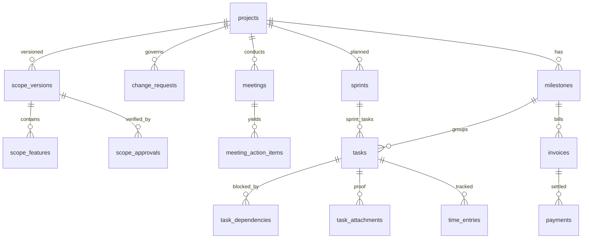

# Phase 4: Project Track — Scope, Governance, Time Tracking & Sprint Planning

> **Status:** 📋 Documented
> **Target Timeline:** Weeks 12–19 (extended from Weeks 12–17)
> **Key Goal:** Provide dispute-proof custom software delivery with locked baseline scopes, client digital approvals, Change Request billing gates, mandatory task proof — plus enterprise additions: per-task time tracking, project budget tracker, sprint planning, task dependency chains, Gantt chart view, and resource capacity planning.

---

## 1. Scope & Features

### 1.1 Scope Baseline (SOW v1)
- Versioned requirement document + feature list with hour estimates.
- Client approves via portal: records **full name, timestamp, IP address, user-agent, drawn/typed signature**.
- Approved version locked as **Baseline (v1)**; auto-generates permanent PDF snapshot stored in S3.
- Zero direct edits after baseline lock — only Change Requests can modify scope.

### 1.2 Change Request (CR) Governance
- Any new requirement triggers a formal Change Request.
- CR captures: Title, description, estimated developer hours, additional cost, timeline delay impact.
- Client approval gate: Approve / Reject / Request Discussion.
- Once approved: Task created, baseline incremented to v2, cost attached to upcoming milestone invoice.

### 1.3 Document Version Control
- Every version of SOW, CR, or attached document is stored with:
  - `version_number`, `created_by`, `created_at`
  - Git-style diff view: compare any two versions side by side.
- Client always sees the latest approved version.
- Previous versions remain in audit trail, downloadable but non-editable.

### 1.4 Meeting Management & MoM
- Meeting details, attendees, agenda, recording/Loom URL, and MoM decisions.
- Action Items: Assigned owner, deadline, 1-click conversion to **Task** or **Change Request**.
- **48-Hour Auto-Acceptance Rule**: Client receives instant notification upon MoM publication. No objection within 48 hours → "Auto-Accepted" (with timestamp).

### 1.5 Kanban Task Management with Proof of Work
- Stages: `Backlog → In Progress → QA/Testing → Client Review → Done`
- Complexity tagging: `Easy`, `Medium`, `Hard` (affects performance score weight).
- **Task dependencies**: Task B cannot move to `In Progress` until Task A is in `Done`.
  - Dependency chain UI shows blocking indicator on blocked tasks.
- **Mandatory Proof Rule**: Task CANNOT move to `Client Review` without at least one attachment (screenshot, Loom video, or staging URL).
- Client Action:
  - **Accept** → Task → `Done` + instant 1–5 star rating modal.
  - **Reject** → Rejection reason mandatory; task back to `In Progress`; `rework_count` incremented.

### 1.6 Per-Task Time Tracking
- Developers log time against tasks using a timer or manual entry.
- Each entry: `started_at`, `ended_at`, duration, `is_billable`, `description`.
- PM sets `estimated_hours` on task. Actual hours = sum of time entries.
- **Over-estimate warning**: When actual > estimated, PM gets alert.
- Billable vs non-billable distinction: rework hours auto-tagged non-billable.

### 1.7 Project Budget Tracker
- Each project has a `total_budget` (from contract value) and tracks:
  - **Estimated cost**: sum(task estimated_hrs × developer hourly_rate)
  - **Actual cost**: sum(task actual_hrs × developer hourly_rate)
  - **Budget consumed %**: actual ÷ total_budget × 100
- Real-time budget bar shown to PM on project dashboard.
- Alert at 80% and 100% budget consumption → admin notified.
- Margin report: total_value (client price) − actual_cost = gross margin.

### 1.8 Sprint Planning Module
- PM groups tasks into **Sprints** (default: 2-week timeboxes).
- Sprint has: name, start_date, end_date, velocity_target (story points or hours).
- **Sprint board**: tasks within the sprint, their completion status.
- **Burndown chart**: Remaining hours/points over sprint days.
- **Velocity tracking**: Avg story points delivered per sprint (trailing 3 sprints).
- After sprint: Sprint Retrospective notes (what went well / what to improve).

### 1.9 Gantt Chart View
- Timeline visualization of milestones + tasks across the project.
- Tasks shown as bars with: assignee avatar, start/end dates, status color.
- Dependency arrows between tasks.
- Critical path highlighted (tasks with no slack).
- Clickable to open task detail panel.
- PM can adjust dates by drag-and-drop (updates due_date via API).

### 1.10 Resource Capacity Planning
- Admin/PM views a **team availability matrix** (who is available when):
  - Each developer: their active tasks, estimated remaining hours, and available capacity next 2 weeks.
  - Calculated from: estimated_hours − actual_hours on open tasks.
- When assigning a task, PM sees a "capacity gauge" per developer.
- Alert: Developer over-allocated (>40h/week estimated) shown in red.
- Cross-project view: Admin sees all PMs' team allocations side by side.

### 1.11 Milestones & Payment Gates
- Milestone progress tracking linked to task completion %.
- Completion triggers invoice generation.
- **Payment Pending Gate**: If milestone invoice is overdue, project auto-moves to `On Hold: Payment Pending` (admin configurable).
- GST-compliant invoice format with partial payment support.

---

## 2. Database Schema (Phase 4)



### 2.1 Table: `projects`
| Column | Type | Attributes | Description |
|---|---|---|---|
| `id` | BIGINT UNSIGNED | PK, Auto-increment | |
| `client_id` | BIGINT UNSIGNED | FK → clients.id | Client organization |
| `client_service_id` | BIGINT UNSIGNED | Nullable, FK → client_services.id | Linked service |
| `name` | VARCHAR(255) | | Project title |
| `status` | ENUM | 'draft', 'scope_approved', 'in_dev', 'client_review', 'on_hold', 'completed', 'closed' | |
| `pm_id` | BIGINT UNSIGNED | FK → users.id | Lead Project Manager |
| `start_date` | DATE | Nullable | Planned start |
| `target_end_date` | DATE | Nullable | Estimated delivery |
| `total_value` | DECIMAL(12,2) | Default: 0 | Client contract price |
| `total_budget` | DECIMAL(12,2) | Default: 0 | Internal cost budget |
| `sprint_duration_days` | TINYINT | Default: 14 | Sprint length |
| `timestamps` | TIMESTAMP | | |

### 2.2 Table: `scope_versions`
| Column | Type | Attributes | Description |
|---|---|---|---|
| `id` | BIGINT UNSIGNED | PK, Auto-increment | |
| `project_id` | BIGINT UNSIGNED | FK → projects.id, Cascade | |
| `version_number` | INT | | 1, 2, 3... |
| `document_body` | LONGTEXT | | SOW markdown/HTML |
| `pdf_snapshot_url` | VARCHAR(500) | Nullable | Permanent archive PDF |
| `diff_from_version_id` | BIGINT UNSIGNED | Nullable, FK → scope_versions.id | Version this was diffed from |
| `is_baseline` | BOOLEAN | Default: false | Active approved contract |
| `status` | ENUM | 'draft', 'pending_approval', 'approved', 'superseded' | |
| `timestamps` | TIMESTAMP | | |

### 2.3 Table: `tasks`
| Column | Type | Attributes | Description |
|---|---|---|---|
| `id` | BIGINT UNSIGNED | PK, Auto-increment | |
| `project_id` | BIGINT UNSIGNED | FK → projects.id | |
| `sprint_id` | BIGINT UNSIGNED | Nullable, FK → sprints.id | Current sprint |
| `milestone_id` | BIGINT UNSIGNED | Nullable, FK → milestones.id | Billing milestone link |
| `source_type` | ENUM | 'scope', 'change_request', 'meeting_action' | Origin of task |
| `source_id` | BIGINT UNSIGNED | | Polymorphic source ID |
| `title` | VARCHAR(255) | | |
| `description` | LONGTEXT | Nullable | |
| `assignee_id` | BIGINT UNSIGNED | Nullable, FK → users.id | Developer |
| `status` | ENUM | 'backlog', 'in_progress', 'qa', 'client_review', 'done' | Default: 'backlog' |
| `priority` | ENUM | 'low', 'medium', 'high', 'critical' | Default: 'medium' |
| `complexity` | ENUM | 'easy', 'medium', 'hard' | Default: 'medium' |
| `story_points` | TINYINT | Nullable | Sprint planning estimate |
| `estimated_hours` | DECIMAL(6,2) | Nullable | PM estimate |
| `actual_hours` | DECIMAL(6,2) | Computed | Sum of time_entries |
| `due_date` | DATE | Nullable | |
| `completed_at` | DATETIME | Nullable | |
| `rework_count` | SMALLINT | Default: 0 | Client rejection count |
| `is_proof_attached` | BOOLEAN | Default: false | Computed from attachments |
| `timestamps` | TIMESTAMP | | |
| `deleted_at` | TIMESTAMP | Nullable | Soft delete |

### 2.4 Table: `task_dependencies`
| Column | Type | Attributes | Description |
|---|---|---|---|
| `id` | BIGINT UNSIGNED | PK, Auto-increment | |
| `task_id` | BIGINT UNSIGNED | FK → tasks.id | The blocked task |
| `depends_on_task_id` | BIGINT UNSIGNED | FK → tasks.id | Task that must complete first |
| `timestamps` | TIMESTAMP | | |

### 2.5 Table: `time_entries`
| Column | Type | Attributes | Description |
|---|---|---|---|
| `id` | BIGINT UNSIGNED | PK, Auto-increment | |
| `task_id` | BIGINT UNSIGNED | FK → tasks.id | |
| `user_id` | BIGINT UNSIGNED | FK → users.id | Developer who logged |
| `started_at` | DATETIME | | |
| `ended_at` | DATETIME | Nullable | Null = currently running timer |
| `duration_minutes` | INT | Computed | (ended_at - started_at) in minutes |
| `is_billable` | BOOLEAN | Default: true | |
| `description` | VARCHAR(500) | Nullable | What was done in this session |
| `timestamps` | TIMESTAMP | | |

### 2.6 Table: `sprints`
| Column | Type | Attributes | Description |
|---|---|---|---|
| `id` | BIGINT UNSIGNED | PK, Auto-increment | |
| `project_id` | BIGINT UNSIGNED | FK → projects.id | |
| `name` | VARCHAR(100) | | e.g. "Sprint 1 — Auth & Dashboard" |
| `start_date` | DATE | | |
| `end_date` | DATE | | |
| `velocity_target` | DECIMAL(6,2) | Nullable | Target story points or hours |
| `velocity_achieved` | DECIMAL(6,2) | Nullable | Actual at sprint close |
| `retrospective_notes` | TEXT | Nullable | What went well / what to improve |
| `status` | ENUM | 'planned', 'active', 'completed' | Default: 'planned' |
| `timestamps` | TIMESTAMP | | |

### 2.7 Table: `invoices`
| Column | Type | Attributes | Description |
|---|---|---|---|
| `id` | BIGINT UNSIGNED | PK, Auto-increment | |
| `project_id` | BIGINT UNSIGNED | Nullable, FK → projects.id | |
| `client_service_id` | BIGINT UNSIGNED | Nullable, FK → client_services.id | For retainer invoices |
| `milestone_id` | BIGINT UNSIGNED | Nullable, FK → milestones.id | |
| `invoice_number` | VARCHAR(50) | Unique | Auto-generated, e.g. INV-2026-0042 |
| `amount` | DECIMAL(12,2) | | Pre-tax amount |
| `cgst_amount` | DECIMAL(10,2) | Default: 0 | |
| `sgst_amount` | DECIMAL(10,2) | Default: 0 | |
| `igst_amount` | DECIMAL(10,2) | Default: 0 | |
| `total_amount` | DECIMAL(12,2) | | amount + taxes |
| `status` | ENUM | 'draft', 'sent', 'partial', 'paid', 'overdue', 'cancelled' | |
| `due_date` | DATE | | |
| `paid_at` | DATETIME | Nullable | |
| `timestamps` | TIMESTAMP | | |

---

## 3. Backend Architecture & Contracts

### 3.1 Service Interfaces

**`App\Contracts\Services\ProjectServiceInterface`**
- `createProject(Client $client, array $data): Project`
- `getBudgetSnapshot(Project $project): array`
- `getCapacityMatrix(Project $project, int $weeksAhead = 2): array`

**`App\Contracts\Services\ScopeServiceInterface`**
- `createScopeVersion(Project $project, array $data, User $author): ScopeVersion`
- `approveScope(ScopeVersion $scope, User $client, string $ip): ScopeApproval`
- `diffVersions(ScopeVersion $v1, ScopeVersion $v2): array`

**`App\Contracts\Services\TaskServiceInterface`**
- `createTask(array $data): Task`
- `moveTaskStatus(Task $task, string $newStatus, User $actor): Task`
- `attachProof(Task $task, UploadedFile $file, string $type, User $actor): TaskAttachment`
- `acceptTask(Task $task, array $ratingData, User $client): Task`
- `rejectTask(Task $task, string $reason, User $client): Task`
- `checkDependenciesMet(Task $task): bool`

**`App\Contracts\Services\TimeTrackingServiceInterface`**
- `startTimer(Task $task, User $user): TimeEntry`
- `stopTimer(TimeEntry $entry, ?string $description): TimeEntry`
- `logManualEntry(Task $task, User $user, array $data): TimeEntry`
- `getProjectTimeSummary(Project $project): array`

**`App\Contracts\Services\SprintServiceInterface`**
- `createSprint(Project $project, array $data): Sprint`
- `assignTasksToSprint(Sprint $sprint, array $taskIds): int`
- `getBurndownData(Sprint $sprint): array`
- `closeSprint(Sprint $sprint, string $retrospectiveNotes): Sprint`

### 3.2 Task Dependency Guard

```php
// app/Actions/Tasks/MoveTaskStatusAction.php
public function execute(Task $task, string $newStatus, User $actor): Task
{
    if ($newStatus === 'in_progress') {
        $blocked = $task->dependsOn()
            ->where('status', '!=', 'done')
            ->exists();
        if ($blocked) {
            throw new TaskDependencyNotMetException($task);
        }
    }

    if ($newStatus === 'client_review') {
        if (!$task->attachments()->exists()) {
            throw new ProofRequiredException($task);
        }
    }

    $task->update(['status' => $newStatus]);
    event(new TaskStatusChanged($task, $actor));
    return $task;
}
```

### 3.3 Budget Tracker Computation

```php
// Computed in ProjectService::getBudgetSnapshot()
// Requires developer hourly_rate on users table
$budgetData = [
    'total_budget'    => $project->total_budget,
    'estimated_cost'  => DB::table('tasks')
        ->join('users', 'tasks.assignee_id', '=', 'users.id')
        ->where('tasks.project_id', $project->id)
        ->sum(DB::raw('tasks.estimated_hours * users.hourly_rate')),
    'actual_cost'     => DB::table('time_entries')
        ->join('tasks', 'time_entries.task_id', '=', 'tasks.id')
        ->join('users', 'time_entries.user_id', '=', 'users.id')
        ->where('tasks.project_id', $project->id)
        ->where('time_entries.is_billable', true)
        ->sum(DB::raw('(time_entries.duration_minutes / 60) * users.hourly_rate')),
    'margin'          => $project->total_value - $actualCost,
];
```

### 3.4 Scheduled Commands

```php
// routes/console.php

// Check overdue milestone invoices and put project on hold
Schedule::command('projects:check-payment-hold')->dailyAt('08:00');

// Check sprint end dates, auto-close completed sprints
Schedule::command('sprints:close-expired')->dailyAt('01:00');

// Capacity over-allocation alerts for PMs
Schedule::command('resources:check-overallocation')->weeklyOn(1, '08:00');
```

---

## 4. API Endpoints

| Method | Endpoint | Description | Auth |
|---|---|---|---|
| `GET` | `/api/v1/projects` | List all projects (with budget snapshot) | Sanctum |
| `GET` | `/api/v1/projects/{id}` | Project detail + budget + capacity | Sanctum |
| `POST` | `/api/v1/projects` | Create project | Sanctum (PM+) |
| `POST` | `/api/v1/projects/{id}/scope` | Create new scope version | Sanctum (PM+) |
| `POST` | `/api/v1/scope/{id}/approve` | Client digitally approves scope | Sanctum (Client) |
| `GET` | `/api/v1/scope/{v1}/diff/{v2}` | Diff two scope versions | Sanctum |
| `POST` | `/api/v1/projects/{id}/change-requests` | Raise a Change Request | Sanctum |
| `PATCH` | `/api/v1/change-requests/{id}/decision` | Client approve/reject CR | Sanctum |
| `POST` | `/api/v1/projects/{id}/meetings` | Log a meeting | Sanctum (PM+) |
| `POST` | `/api/v1/meetings/{id}/confirm` | Client confirms MoM | Sanctum (Client) |
| `GET` | `/api/v1/projects/{id}/tasks` | List project tasks (+ Kanban) | Sanctum |
| `POST` | `/api/v1/tasks` | Create task | Sanctum (PM+) |
| `PATCH` | `/api/v1/tasks/{id}/status` | Move task through stages | Sanctum |
| `POST` | `/api/v1/tasks/{id}/attachments` | Upload proof attachment | Sanctum |
| `POST` | `/api/v1/tasks/{id}/accept` | Client accepts task + rating | Sanctum (Client) |
| `POST` | `/api/v1/tasks/{id}/reject` | Client rejects task | Sanctum (Client) |
| `POST` | `/api/v1/tasks/{id}/dependencies` | Add task dependency | Sanctum (PM+) |
| `POST` | `/api/v1/tasks/{id}/time-entries` | Log time entry / start timer | Sanctum |
| `PATCH` | `/api/v1/time-entries/{id}/stop` | Stop running timer | Sanctum |
| `GET` | `/api/v1/projects/{id}/sprints` | List sprints | Sanctum |
| `POST` | `/api/v1/projects/{id}/sprints` | Create sprint | Sanctum (PM+) |
| `POST` | `/api/v1/sprints/{id}/tasks` | Assign tasks to sprint | Sanctum (PM+) |
| `GET` | `/api/v1/sprints/{id}/burndown` | Sprint burndown data | Sanctum |
| `PATCH` | `/api/v1/sprints/{id}/close` | Close sprint with retrospective | Sanctum (PM+) |
| `GET` | `/api/v1/projects/{id}/gantt` | Gantt chart data (tasks + milestones + dependencies) | Sanctum |
| `GET` | `/api/v1/projects/{id}/budget` | Budget snapshot + margin | Sanctum (PM+) |
| `GET` | `/api/v1/projects/{id}/capacity` | Team capacity matrix (next 2 weeks) | Sanctum (PM+) |
| `GET` | `/api/v1/projects/{id}/milestones` | List milestones | Sanctum |
| `POST` | `/api/v1/milestones/{id}/invoice` | Generate invoice for milestone | Sanctum (PM+) |

---

## 5. Frontend Deliverables

### 5.1 Project Dashboard
- Summary header: status badge, progress %, budget bar, days remaining.
- Tabs: Overview | Tasks | Sprints | Gantt | Budget | Meetings | Scope | Change Requests | Milestones | Chat.

### 5.2 Kanban Board (Project Tasks)
- 5 columns: Backlog, In Progress, QA, Client Review, Done.
- Cards show: title, assignee avatar, complexity badge, proof indicator, dependency chain indicator.
- Drag-and-drop with dependency validation (cannot move to In Progress if blocked).
- "Upload Proof" appears on card hover in QA column.

### 5.3 Time Tracker Widget
- Persistent timer panel (top-right corner of project screens).
- One-click "Start Timer" against the current task.
- Daily time log view per developer: tasks + hours + billable indicator.

### 5.4 Sprint Board
- Sprint selector dropdown (current sprint highlighted).
- Sprint progress bar: tasks completed / total.
- Burndown chart (Recharts line chart: ideal vs actual remaining).
- "Close Sprint" button → opens retrospective form → shows velocity comparison.

### 5.5 Gantt Chart View
- Recharts/gantt-task-react timeline chart.
- Tasks as bars, milestones as diamonds, dependencies as arrows.
- Color coding by status (green=done, blue=in_progress, red=overdue).
- Zoom: Day / Week / Month view toggle.
- PM drag-to-reschedule with API update on drop.

### 5.6 Budget Tracker Panel
- Radial gauge: % of budget consumed.
- Cost breakdown table: estimated vs actual per developer.
- Margin indicator: green (positive margin) / red (negative margin).
- Alert banner at 80% consumption.

### 5.7 Resource Capacity Matrix
- Grid view: Developers (rows) × Weeks (columns).
- Cell value: available hours that week.
- Color: green (available), yellow (80%+ booked), red (over-allocated).
- Click developer → open their full task list + timeline.

### 5.8 Scope Version Diff Viewer
- Side-by-side diff (like GitHub's diff view) with added lines (green) and removed lines (red).
- "Approve This Version" button on right panel (client view).

---

## 6. Definition of Done (Phase 4)

- [ ] Scope digital approval records: name, timestamp, IP, signature — stored and non-editable.
- [ ] PDF snapshot generated on scope approval and stored in S3.
- [ ] Task dependency validation: blocked tasks cannot move to In Progress until dependency is Done.
- [ ] Proof enforcement: tasks cannot enter Client Review without at least one attachment.
- [ ] Client accept/reject flow tested: rework_count increments on reject.
- [ ] Time tracking: timer start/stop, manual entry, actual_hours computed correctly.
- [ ] Budget tracker: cost computed from time entries × hourly rate matches manual calculation.
- [ ] Budget alert fires at 80% consumption threshold.
- [ ] Sprint creation, task assignment, burndown calculation verified.
- [ ] Gantt chart renders tasks and dependencies correctly.
- [ ] Capacity matrix shows correct available hours per developer across projects.
- [ ] Retainer invoice auto-generated by scheduler and delivered via email.
- [ ] Feature tests for all Project, Task, Sprint, Time Entry, and Invoice endpoints: 100% assertions passing.
- [ ] Cross-project data isolation: developer only sees assigned project tasks.
