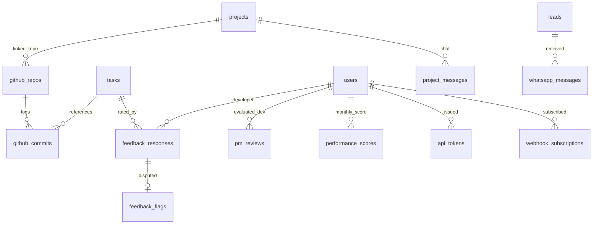

# Phase 5: Integrations, Performance Engine & Public API

> **Status:** 📋 Documented
> **Target Timeline:** Weeks 20–26 (extended)
> **Key Goal:** Implement GitHub activity tracking, real-time project communication, structured multi-level feedback, an objective 0–100 Developer Performance Engine, 2-way WhatsApp API integration, AI-powered assistant hints, and a Public REST API with webhooks for client integrations.

---

## 1. Scope & Features

### 1.1 GitHub Repository Integration
- Link project to GitHub repository via GitHub App / Webhook.
- Automatically extract and link commits using pattern: `TASK-{id}: message`.
- Track developer activity: commits, lines added/deleted, merged pull requests.
- Webhook signature verification (HMAC-SHA256) rejects unauthorized payloads.

### 1.2 Real-time Project Chat & Internal Notes
- Project-wide chat channel for Client · PM · Developer (Laravel Reverb / WebSockets).
- **Internal Notes Channel**: Secure sub-channel visible only to PM, Developer, Admin (hidden from Client).
- Messages are immutable (soft-archived, never hard deleted).
- File sharing, emoji reactions, @mentions.
- Clear visual distinction between Internal and Client-visible messages.

### 1.3 2-Way WhatsApp API Integration
- **Outbound** (already in Phase 1): follow-up reminders, overdue alerts, daily digest.
- **Phase 5 Addition — Inbound**: Agents can receive client replies via WhatsApp.
  - Client replies "1" for interested, "2" for not now, "3" for callback — auto-mapped to lead actions.
  - Incoming messages stored in lead timeline with timestamp.
- **Project notifications via WhatsApp**: Client receives MoM, task-ready, invoice alerts.
- Built on Meta Cloud API (graph.facebook.com/v18.0/{phone_id}/messages).
- WhatsApp conversation logs stored in `whatsapp_messages` table.
- Rate limiting and opt-out (STOP keyword) handled.

### 1.4 Pulse Survey Automation (NPS)
- Auto-send after: milestone completion, sprint closure, project close.
- Short 2–3 question NPS + comment prompt.
- NPS score (0–10) tracked per client, per period.
- **NPS dashboard**: Promoters (9–10), Passives (7–8), Detractors (0–6) breakdown.
- Low NPS (<6) triggers admin alert and is excluded from developer score until reviewed.

### 1.5 Structured Multi-Level Feedback
- **Task Accept Rating**: Quick 1–5 star prompt when client approves a task.
- **Milestone Complete Review**: 6-parameter evaluation:
  1. Work Quality, 2. Communication, 3. Timeliness, 4. Requirement Understanding, 5. Professionalism, 6. "Would you work again?" (Yes/No)
- **Low Rating Alert**: 1–2 star ratings require written comment and trigger instant notification to Super Admin.

### 1.6 0–100 Multi-Signal Performance Score
$$\text{Score} = (0.30 \times \text{ClientRating}) + (0.20 \times \text{OnTime\%}) + (0.20 \times \text{LowRework}) + (0.15 \times \text{PMReview}) + (0.10 \times \text{EstAccuracy}) + (0.05 \times \text{ResponseTime})$$

- **Complexity Weighting**: `Hard` tasks carry higher positive weight on on-time delivery.
- **Minimum Threshold Rule**: Score hidden ("Not enough data") until developer has 5+ rated tasks or 30 days of activity.
- **All weights admin-configurable** via `score_config` table.

### 1.7 Fairness & Dispute Resolution
- Full Developer Transparency: Developers inspect their score breakdown and exact formula.
- **Dispute Flagging**: Developers contest unreasonable client reviews. Admin reviews and can mark "Excluded from Score" with a stated reason.
- **Scope Issue Tag**: Negative feedback due to refused out-of-scope work can be excluded.

### 1.8 AI Assistant Hints
- **Lead suggestions**: "No contact in 5 days — schedule a call", "Similar leads in Negotiation stage converted within 3 days of a proposal PDF".
- **Meeting summarizer**: Auto-summarize long MoM text into bullet-point action items (via OpenAI API).
- **Sprint risk flag**: If current sprint is behind by >30%, AI flags "Sprint at risk" with resource suggestions.
- **All AI suggestions are advisory only** — always shown as "Suggestion", never auto-actioned.
- AI data never leaves the system (no client data sent to AI raw — only anonymized patterns used for suggestions).

### 1.9 Public REST API + Webhooks
- Organizations can issue **API tokens** from settings to integrate the platform.
- Public API scope: leads (create/read), clients (read), project status (read), invoices (read).
- Webhooks: Subscribe to events (lead.created, lead.won, invoice.paid, task.done).
  - Each webhook delivery logged with status, response code, retry count.
  - **Retry logic**: 3 retries with exponential backoff on non-2xx response.
- **Zapier integration**: Documented Zap for common triggers (lead created → Slack message, invoice paid → Google Sheets row).

---

## 2. Database Schema (Phase 5)



### 2.1 Table: `github_repos` & `github_commits`
| Table | Key Columns | Description |
|---|---|---|
| `github_repos` | `id, project_id, repo_full_name, webhook_secret, is_active` | Project repo config |
| `github_commits` | `id, repo_id, sha, author_github, user_id, task_id, message, additions, deletions, committed_at` | Webhook ingested commits |
| `github_pull_requests` | `id, repo_id, pr_number, title, author, state, merged_at` | PR tracking |

### 2.2 Table: `whatsapp_messages`
| Column | Type | Attributes | Description |
|---|---|---|---|
| `id` | BIGINT UNSIGNED | PK, Auto-increment | |
| `direction` | ENUM | 'inbound', 'outbound' | |
| `notifiable_type` | VARCHAR(255) | | 'Lead' or 'User' (client) |
| `notifiable_id` | BIGINT UNSIGNED | | |
| `from_number` | VARCHAR(20) | | Sender phone number |
| `to_number` | VARCHAR(20) | | Recipient phone number |
| `message_body` | TEXT | | |
| `wa_message_id` | VARCHAR(100) | Nullable | Meta's message ID |
| `status` | ENUM | 'sent', 'delivered', 'read', 'failed', 'received' | |
| `received_at` | DATETIME | | |
| `timestamps` | TIMESTAMP | | |

### 2.3 Table: `feedback_responses`
| Column | Type | Attributes | Description |
|---|---|---|---|
| `id` | BIGINT UNSIGNED | PK, Auto-increment | |
| `task_id` | BIGINT UNSIGNED | Nullable, FK → tasks.id | |
| `milestone_id` | BIGINT UNSIGNED | Nullable, FK → milestones.id | |
| `project_id` | BIGINT UNSIGNED | FK → projects.id | |
| `developer_id` | BIGINT UNSIGNED | FK → users.id | |
| `client_user_id` | BIGINT UNSIGNED | FK → users.id | |
| `rating` | DECIMAL(3,2) | 1.00 to 5.00 | Average |
| `quality` | INT | 1 to 5 | |
| `communication` | INT | 1 to 5 | |
| `timeliness` | INT | 1 to 5 | |
| `understanding` | INT | 1 to 5 | |
| `would_work_again` | BOOLEAN | | Net promoter indicator |
| `comment` | TEXT | Nullable | Required if rating ≤ 2 |
| `is_excluded` | BOOLEAN | Default: false | Admin dispute exclusion |
| `exclusion_reason` | TEXT | Nullable | |
| `timestamps` | TIMESTAMP | | |

### 2.4 Table: `performance_scores`
| Column | Type | Attributes | Description |
|---|---|---|---|
| `id` | BIGINT UNSIGNED | PK, Auto-increment | |
| `developer_id` | BIGINT UNSIGNED | FK → users.id | |
| `period` | VARCHAR(7) | Indexed | e.g. `2026-09` |
| `final_score` | DECIMAL(5,2) | 0.00–100.00 | |
| `client_score` | DECIMAL(5,2) | | |
| `ontime_score` | DECIMAL(5,2) | | |
| `rework_score` | DECIMAL(5,2) | | |
| `pm_score` | DECIMAL(5,2) | | |
| `estimate_score` | DECIMAL(5,2) | | |
| `sample_size` | INT | | Tasks evaluated in period |
| `breakdown_json` | JSON | | Full calculation metadata |
| `timestamps` | TIMESTAMP | | |

### 2.5 Table: `webhook_subscriptions`
| Column | Type | Attributes | Description |
|---|---|---|---|
| `id` | BIGINT UNSIGNED | PK, Auto-increment | |
| `user_id` | BIGINT UNSIGNED | FK → users.id | API token owner |
| `event` | VARCHAR(100) | | 'lead.created', 'invoice.paid', etc. |
| `url` | VARCHAR(500) | | HTTPS endpoint |
| `secret` | VARCHAR(255) | | HMAC signing secret |
| `is_active` | BOOLEAN | Default: true | |
| `last_triggered_at` | DATETIME | Nullable | |
| `timestamps` | TIMESTAMP | | |

### 2.6 Table: `nps_responses`
| Column | Type | Attributes | Description |
|---|---|---|---|
| `id` | BIGINT UNSIGNED | PK, Auto-increment | |
| `client_id` | BIGINT UNSIGNED | FK → clients.id | |
| `trigger_type` | ENUM | 'milestone', 'sprint', 'project_close' | |
| `trigger_id` | BIGINT UNSIGNED | | Polymorphic ID |
| `score` | TINYINT | 0–10 | NPS score |
| `comment` | TEXT | Nullable | |
| `category` | ENUM | 'promoter', 'passive', 'detractor' | Computed |
| `responded_at` | DATETIME | | |
| `timestamps` | TIMESTAMP | | |

---

## 3. Backend Architecture & Contracts

### 3.1 Service Interfaces

**`App\Contracts\Services\PerformanceServiceInterface`**
- `calculateDeveloperMonthlyScore(int $developerId, string $period): PerformanceScore`
- `recalculateAllScores(string $period): int`
- `disputeFeedback(int $feedbackId, string $reason, User $developer): void`
- `resolveDispute(int $feedbackId, bool $exclude, string $adminNotes, User $admin): void`

**`App\Contracts\Services\GitHubWebhookServiceInterface`**
- `processPushEvent(array $payload, string $signature): void`
- `processPullRequestEvent(array $payload): void`

**`App\Contracts\Services\ChatServiceInterface`**
- `sendMessage(int $projectId, string $message, bool $isInternal, User $sender, array $files): ProjectMessage`

**`App\Contracts\Services\WhatsAppServiceInterface`**
- `sendTemplate(string $phone, string $template, array $params): void`
- `processInboundWebhook(array $payload): void`
- `mapInboundReplyToAction(WhatsAppMessage $message): void`

**`App\Contracts\Services\PublicApiWebhookServiceInterface`**
- `dispatch(string $event, array $payload): void`
- `retryFailedDeliveries(): int`

**`App\Contracts\Services\AiAssistantServiceInterface`**
- `getLeadSuggestions(Lead $lead): array`
- `summarizeMeetingNotes(string $rawNotes): string`
- `getSprintRiskAssessment(Sprint $sprint): array`

### 3.2 Scheduled Commands

```php
// routes/console.php

// 1st of month at 2:00 AM: recalculate all developer scores
Schedule::command('scores:recalculate-monthly')->monthlyOn(1, '02:00');

// Hourly: retry failed webhook deliveries
Schedule::command('webhooks:retry-failed')->hourly();

// Daily: send NPS surveys due (milestone complete, sprint close)
Schedule::command('nps:dispatch-pending-surveys')->dailyAt('10:00');
```

### 3.3 Public API Authentication
```php
// API tokens stored in personal_access_tokens with 'public_api' ability
// Middleware: auth:sanctum + ability:public_api
// X-API-Key header → Sanctum token lookup
```

### 3.4 Webhook Delivery Logic
```php
// app/Actions/Webhooks/DispatchWebhookAction.php
public function execute(string $event, array $payload): void
{
    $subscriptions = WebhookSubscription::where('event', $event)
        ->where('is_active', true)->get();

    foreach ($subscriptions as $subscription) {
        DispatchWebhookJob::dispatch($subscription, $payload)
            ->onQueue('webhooks');
    }
}

// DispatchWebhookJob: tries 3 times with exponential backoff
// Logs delivery: status, http_code, response_body, attempt_count
```

---

## 4. API Endpoints

| Method | Endpoint | Description | Auth |
|---|---|---|---|
| `POST` | `/api/v1/webhooks/github` | Ingest GitHub commits & PRs | Webhook Signature |
| `POST` | `/api/v1/webhooks/whatsapp` | Receive WhatsApp inbound messages | Meta Signature |
| `POST` | `/api/v1/projects/{id}/messages` | Send project chat message | Sanctum |
| `GET` | `/api/v1/projects/{id}/messages` | Paginated chat history | Sanctum |
| `POST` | `/api/v1/feedback/task/{id}` | Submit task completion feedback | Client |
| `POST` | `/api/v1/feedback/milestone/{id}` | Submit milestone 6-point review | Client |
| `POST` | `/api/v1/feedback/{id}/dispute` | Developer disputes feedback | Developer |
| `POST` | `/api/v1/admin/feedback/{id}/resolve` | Admin accepts/rejects dispute | Super Admin |
| `GET` | `/api/v1/developers/{id}/performance` | Score telemetry + breakdown | Dev / Admin / PM |
| `GET` | `/api/v1/admin/performance/leaderboard` | Developer company leaderboard | Super Admin / PM |
| `POST` | `/api/v1/nps/respond` | Client submits NPS survey | Client |
| `GET` | `/api/v1/admin/nps/dashboard` | NPS promoter/passive/detractor breakdown | Admin |
| `GET` | `/api/v1/ai/lead/{id}/suggestions` | AI action suggestions for lead | Sanctum |
| `POST` | `/api/v1/ai/meetings/{id}/summarize` | AI summarize meeting notes | Sanctum (PM+) |
| `GET` | `/api/v1/public/leads` | Public API: list/create leads | API Key |
| `POST` | `/api/v1/public/leads` | Public API: create lead (webhook integration) | API Key |
| `GET` | `/api/v1/public/projects/{id}` | Public API: project status | API Key |
| `GET` | `/api/v1/settings/webhooks` | List webhook subscriptions | Sanctum (Admin) |
| `POST` | `/api/v1/settings/webhooks` | Create webhook subscription | Sanctum (Admin) |

---

## 5. Frontend Deliverables

### 5.1 Developer Self-Service Dashboard
- Visual score breakdown with radar chart across 6 dimensions.
- Transparency panel showing exact formula and variable inputs.
- Received feedback list with "Flag Dispute" button.
- GitHub activity heatmap (contribution graph style).

### 5.2 Dispute Resolution Console (Super Admin)
- Side-by-side: client comment, task attachments, developer's explanation.
- One-click "Exclude from Score" button with required reason input.

### 5.3 Project Real-time Chat
- Split-tab chat: **Client Discussion** vs **Internal Team Channel**.
- Visual badges on internal messages.
- WhatsApp-style message bubbles with delivery status indicators.

### 5.4 NPS Dashboard
- Gauge showing overall NPS score (−100 to +100).
- Trend chart over the last 12 months.
- Response breakdown: Promoters / Passives / Detractors.
- Comment feed with sentiment filter.

### 5.5 AI Suggestions Panel
- Non-intrusive side panel that appears context-sensitively.
- Lead detail: shows action suggestions ("Call due since 5 days").
- Sprint view: shows "Sprint at risk" banner with reasoning.
- Meeting detail: "Summarize MoM" button → shows bullet-point summary.

### 5.6 API & Webhooks Settings (Admin)
- API token management: generate, revoke, copy.
- Webhook subscriptions: create (event type + URL), test, view delivery logs.
- Delivery log table: event, timestamp, HTTP status, retry count.

---

## 6. Definition of Done (Phase 5)

- [ ] GitHub commits matching `TASK-{id}` show on Task detail page.
- [ ] GitHub webhook signature verification rejects unauthorized requests with HTTP 403.
- [ ] WhatsApp outbound template messages delivered to test number.
- [ ] WhatsApp inbound message received, parsed, and added to lead timeline.
- [ ] Client feedback ratings ≤ 2 stars alert Super Admin immediately.
- [ ] Monthly score calculation math verified via PHPUnit for 100% accuracy.
- [ ] Developer dispute exclusion: excluded reviews recalculate score without penalty.
- [ ] NPS survey auto-dispatched after milestone completion.
- [ ] NPS dashboard shows correct promoter/passive/detractor split.
- [ ] AI suggestion for stale lead appears after 5+ days of no contact.
- [ ] Public API: lead creation via API key works and creates correct lead record.
- [ ] Webhook delivery tested: event fires, endpoint receives payload, retry works on failure.
- [ ] Real-time chat messages appear without refresh using Reverb WebSocket.
