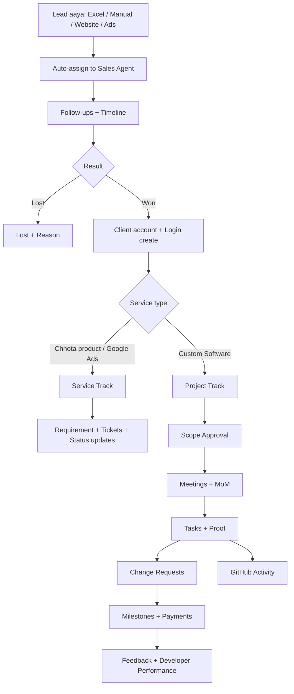
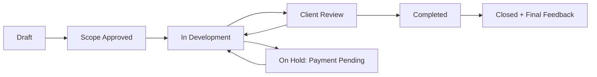
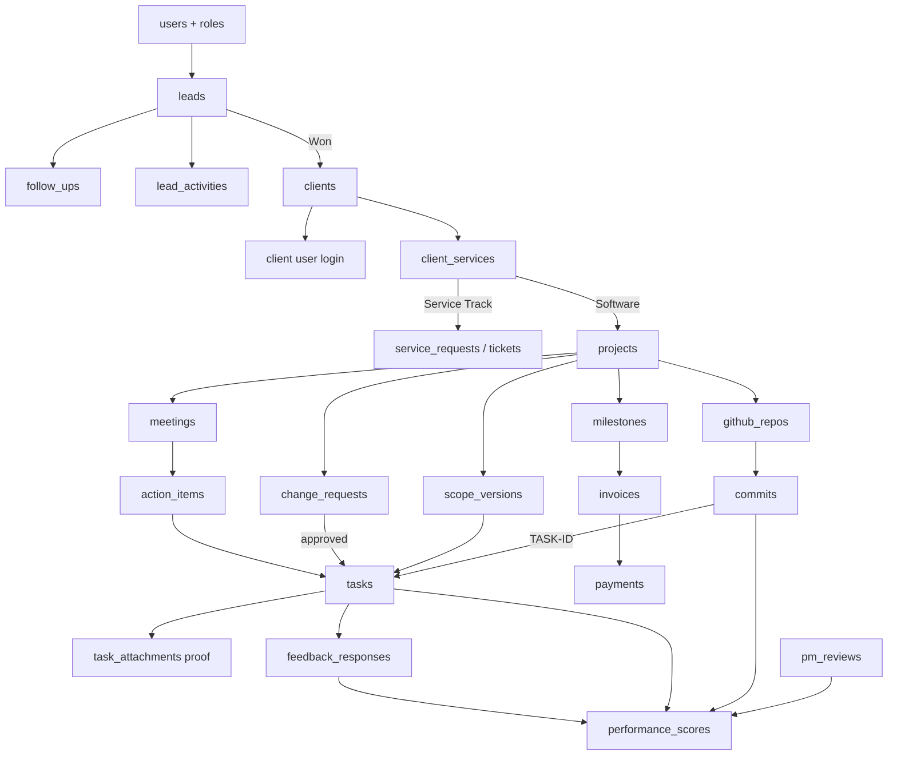

# Agency CRM + Project Delivery Platform
### Enterprise Plan (Laravel + React)

> Ye ek hi platform hai jisme **Sales CRM → Client Portal → Project Delivery → Feedback & Performance** sab jude hue hain. Lead "Won" hote hi uska data automatically client, service ya project me convert ho jaata hai. Kisi cheez ko dobara type nahi karna padta.

---

## Index

1. [Goals aur Problems jo solve honge](#1-goals-aur-problems-jo-solve-honge)
2. [Poori Pipeline (Big Picture)](#2-poori-pipeline-big-picture)
3. [Roles aur Permissions](#3-roles-aur-permissions)
4. [Module 1: Auth, RBAC, Impersonation, Audit](#4-module-1-auth-rbac-impersonation-audit)
5. [Module 2: Lead CRM](#5-module-2-lead-crm)
6. [Module 3: Follow-ups, Alerts, Timeline](#6-module-3-follow-ups-alerts-timeline)
7. [Module 4: Analytics aur Reports](#7-module-4-analytics-aur-reports)
8. [Module 5: Won → Client Conversion](#8-module-5-won--client-conversion)
9. [Module 6: Service Track (Chhote products, Google Ads)](#9-module-6-service-track-chhote-products-google-ads)
10. [Module 7: Project Track (Custom Software)](#10-module-7-project-track-custom-software)
11. [Module 8: Feedback aur Developer Performance](#11-module-8-feedback-aur-developer-performance)
12. [Modules kaise aapas me linked hain](#12-modules-kaise-aapas-me-linked-hain)
13. [Database Design](#13-database-design)
14. [Laravel Backend Architecture](#14-laravel-backend-architecture)
15. [React Frontend Architecture](#15-react-frontend-architecture)
16. [Important Workflows (Step by Step)](#16-important-workflows-step-by-step)
17. [Security aur Compliance](#17-security-aur-compliance)
18. [DevOps aur Deployment](#18-devops-aur-deployment)
19. [Build Roadmap (Phases)](#19-build-roadmap-phases)
20. [Risks aur Practical Tips](#20-risks-aur-practical-tips)

---

## 1. Goals aur Problems jo solve honge

| Problem | Solution (Module) |
|---|---|
| Leads Excel me bikhre hue, follow-up bhool jaate hain | Lead CRM + Follow-up alerts |
| Agent ki performance ka pata nahi | Analytics + Agent reports |
| Lead convert hua to client ko manually setup karna | Won → Client auto-conversion |
| Chhote services (Ads, small products) ka tracking | Service Track + Tickets |
| Client bolta hai "ye task bhi bola tha", paisa nahi deta | Scope approval + Change Request + Meeting MoM + Milestone payment |
| Task ka proof nahi | Task proof (screenshot/video) + Client accept |
| Developer ka kaam kitna hua pata nahi | GitHub integration + Task tracking |
| Developer ki performance judge karna | Feedback + Performance score |
| Admin ko sab ek jagah dekhna hai | Super Admin dashboard + Impersonation |

---

## 2. Poori Pipeline (Big Picture)



**Ek line me:** *Sales team lead laati hai → Won hone par client banta hai → service ke type ke hisaab se Service Track ya Project Track chalta hai → har cheez approval + record ke saath → end me feedback aur performance.*

---

## 3. Roles aur Permissions

### 3.1 Roles ki list

| Role | Kaun hai | Kya dekhta hai |
|---|---|---|
| **Super Admin** | Company owner | Sab kuch, sab modules, sab users, impersonation |
| **Sales Manager** | Sales team ka head | Apni team ke leads, reports, reassign |
| **Sales Agent** | Sales person | Sirf apne assigned leads |
| **Project Manager (PM)** | Delivery head | Assigned projects, meetings, tasks, CRs, PM review |
| **Developer** | Kaam karne wala | Sirf assigned projects/tasks |
| **Support / Account Manager** (optional) | Service track handle kare | Service requests/tickets |
| **Client** | Customer | Sirf apna data (services, projects, invoices) |

### 3.2 Permission Matrix

`✅` = full, `👁` = sirf dekh sakta hai, `🔸` = limited (apna/assigned), `❌` = nahi

| Feature | Super Admin | Sales Mgr | Sales Agent | PM | Developer | Client |
|---|---|---|---|---|---|---|
| Users/Roles manage | ✅ | ❌ | ❌ | ❌ | ❌ | ❌ |
| Impersonation | ✅ | ❌ | ❌ | ❌ | ❌ | ❌ |
| Lead import (Excel) | ✅ | ✅ | 🔸 (apne) | ❌ | ❌ | ❌ |
| Lead create/edit | ✅ | ✅ | 🔸 | ❌ | ❌ | ❌ |
| Lead reassign | ✅ | ✅ | ❌ | ❌ | ❌ | ❌ |
| Follow-ups | ✅ | 👁 team | 🔸 apne | ❌ | ❌ | ❌ |
| Sales analytics | ✅ | 🔸 team | 🔸 apne | ❌ | ❌ | ❌ |
| Lead → Client convert | ✅ | ✅ | ✅ | ❌ | ❌ | ❌ |
| Client profile | ✅ | 👁 | 👁 (apne converted) | 🔸 | 🔸 | 🔸 apna |
| Service requests | ✅ | 👁 | 👁 | 🔸 | ❌ | 🔸 apne |
| Project create | ✅ | ❌ | ❌ | ✅ | ❌ | ❌ |
| Scope / SOW create | ✅ | ❌ | ❌ | ✅ | ❌ | 👁 + Approve |
| Change Request raise | ✅ | ❌ | ❌ | ✅ | 🔸 (suggest) | ✅ (request) |
| Change Request approve | ✅ | ❌ | ❌ | ❌ | ❌ | ✅ |
| Meetings + MoM | ✅ | ❌ | ❌ | ✅ | 🔸 (add notes) | 👁 + Confirm |
| Tasks create/assign | ✅ | ❌ | ❌ | ✅ | 🔸 (update own) | 👁 + Accept/Reject |
| Task proof upload | ✅ | ❌ | ❌ | ✅ | ✅ | 👁 |
| Milestones/Invoices | ✅ | ❌ | ❌ | ✅ | ❌ | 👁 + Pay |
| GitHub analytics | ✅ | ❌ | ❌ | ✅ | 🔸 apna | ❌ |
| Project chat | ✅ (👁 all) | ❌ | ❌ | ✅ | ✅ | ✅ |
| Feedback dena | ❌ | ❌ | ❌ | ❌ | ❌ | ✅ |
| Feedback dekhna | ✅ | ❌ | ❌ | ✅ | 🔸 apna | 🔸 apna diya hua |
| Performance score | ✅ | ❌ | ❌ | ✅ | 🔸 apna | ❌ |
| Audit logs | ✅ | ❌ | ❌ | ❌ | ❌ | ❌ |

> **Implementation note:** Laravel me ye sab **spatie/laravel-permission** (roles + permissions) aur **Policies** se enforce hoga. React me sirf UI hide/show hoga, **asli security hamesha backend me**.

---

## 4. Module 1: Auth, RBAC, Impersonation, Audit

### 4.1 Auth
- Login: email + password (Laravel Sanctum token/SPA cookie).
- 2FA (optional) Super Admin aur Manager ke liye.
- Client ko login **auto-create** hota hai jab lead Won hoti hai (invite email + password set link).
- Har role login ke baad apne **alag dashboard** par jaata hai.

### 4.2 Impersonation (Super Admin kisi ka bhi panel dekh sake)

**Kaise kaam karta hai:**
1. Super Admin user list me "View as" button dabata hai.
2. Backend `impersonation_logs` me entry karta hai (kisne, kiska panel, kab, IP).
3. Target user ka **temporary token** (short expiry, jaise 60 min) banta hai.
4. React me upar **banner** dikhta hai: *"Aap Rahul (Sales Agent) ke panel me hain. [Exit]"*
5. Exit dabane par admin apne original session me wapas.

**Rules:**
- Impersonation me **destructive actions** (delete, payment mark, password change) by default block, ya audit me "by admin (impersonating X)" tag ke saath ho.
- Sirf Super Admin. Kisi ko impersonate karne ka reason (optional field) le sakte hain.
- Har impersonation session log hoga aur report me dikhega.

### 4.3 Audit Log
- **Har important action** immutable table me: kisne, kya, kab, old value, new value, IP.
- Package: `spatie/laravel-activitylog`.
- Approve/Reject, scope changes, payment status, lead reassign, feedback edit/exclude sab log hote hain.
- Ye table **sirf insert** hoti hai, edit/delete permission kisi ko nahi.

---

## 5. Module 2: Lead CRM

### 5.1 Lead capture ke tareeke
| Source | Kaise |
|---|---|
| **Excel import** | Upload → column mapping → preview → duplicate check (phone/email) → import |
| **Manual entry** | Form se ek lead add |
| **Website form / Meta / Google Ads** | Webhook/API endpoint (Phase 5) |
| **Bulk assign** | Import ke time hi agent select ya auto-assign rule |

### 5.2 Excel import ka flow
```
Upload .xlsx/.csv
   → Column mapping screen (Name = "Client Name", Phone = "Mobile" ...)
   → Validation (invalid phone, empty name)
   → Duplicate check (phone/email match hua to: Skip / Update / Add anyway)
   → Assign rule: Specific agent / Round-robin / Product-wise
   → Background job (queue) me import
   → Summary: 200 imported, 12 duplicates, 5 errors (error file download)
```
Package: **maatwebsite/excel** + Laravel Queue.

### 5.3 Auto-assignment rules
- **Round-robin:** agents me barabar baant do.
- **Product-wise:** Software ka lead → software wale agents ko, Ads ka → ads team ko.
- **Manual:** Manager ya admin khud select kare.
- **Load-based:** jiske paas kam active leads hain usko.

### 5.4 Lead ke fields
`name, phone, alt_phone, email, company, city, source, interested_products (multiple), budget, priority (Hot/Warm/Cold), status, assigned_agent, tags, created_by (import/manual), notes`

### 5.5 Lead Status Stages
```
New → Contacted → Interested → Demo/Meeting → Proposal → Negotiation → Won
                                                                     ↘ Lost (reason mandatory)
```
- Status change ka **timeline entry** automatic banta hai.
- **Lost** karte waqt reason dropdown mandatory: Price, No response, Competitor, Not needed, Wrong number, Other.

### 5.6 Behaviour Tags
"Phone nahi uthata", "Price sensitive", "Decision maker nahi", "WhatsApp pe reply karta hai", "Urgent requirement" etc. Admin tags configure kar sakta hai. Analytics me in tags se pattern nikalte hain.

### 5.7 Agent ke liye Lead screens
- **My Leads** list (filters: status, priority, product, date, source)
- **Lead Detail page:** profile + timeline + follow-ups + notes + convert button
- **Kanban view:** stage-wise drag and drop

---

## 6. Module 3: Follow-ups, Alerts, Timeline

### 6.1 Follow-up system (ek lead ke multiple follow-ups)

Har follow-up alag row hai (`follow_ups` table):

| Field | Example |
|---|---|
| Lead | Rahul Sharma |
| Type | Call / WhatsApp / Email / Meeting |
| Scheduled date-time | 30 Sep 2026, 4:00 PM |
| Status | Pending / Done / Missed / Rescheduled |
| Outcome notes | "Demo ke liye ready hai" |
| Next follow-up | 3 Oct 2026 |

**Flow:** Follow-up "Done" mark karte hi system poochta hai **"Next follow-up kab?"** (mandatory jab tak lead open hai). Isse chain kabhi tootti nahi.

### 6.2 Alerts

| Alert | Kahan dikhega |
|---|---|
| **Aaj ke follow-ups** | Agent dashboard ke top pe card |
| **Overdue follow-ups** (red) | Dashboard + badge count |
| **Notification bell** | Sabhi pages par (real-time) |
| **Daily digest** | Subah 9 baje email/WhatsApp: "Aaj aapke 8 follow-ups hain" |
| **Reminder** | Follow-up se 15 min pehle push/in-app |
| **Escalation** | Follow-up 24 ghante miss hua → Manager ko alert |
| **Stale lead** | 7 din se koi activity nahi → alert |

**Laravel me:** Scheduler (`php artisan schedule`) har minute check karega, Queue jobs notifications bhejenge, **Laravel Reverb / Pusher** real-time bell ke liye.

### 6.3 Timeline (Activity Feed)
Har lead ka ek chronological feed:
```
📥 Lead imported by Admin (Excel)               10 Sep, 10:00
👤 Assigned to Rahul                            10 Sep, 10:01
📞 Call done: "Interested, demo chahiye"        11 Sep, 12:30
📅 Follow-up scheduled for 14 Sep               11 Sep, 12:31
🔄 Status: Contacted → Interested               11 Sep, 12:31
📝 Note added: "Budget 50k"                     12 Sep, 09:10
🔁 Reassigned Rahul → Priya                     15 Sep, 11:00
🏆 Status: Won                                  20 Sep, 16:00
```
Table: `lead_activities` (polymorphic: type, payload JSON, user, timestamp).

---

## 7. Module 4: Analytics aur Reports

### 7.1 Super Admin dashboard (sab ek saath)
- Total leads, conversion %, revenue, active projects, pending payments
- Leads by source / product / agent
- **Conversion funnel** (New → Won, har stage par drop-off)
- Lost reasons pie chart
- Service-wise revenue (Software / Ads / Small products)
- Agent leaderboard
- Overdue follow-ups (company-wide)

### 7.2 Agent Report

| Metric | Matlab |
|---|---|
| Leads assigned | Kitne mile |
| Contacted % | Kitno se baat hui |
| Follow-ups done / missed | Discipline |
| Conversion % | Won ÷ Total |
| Revenue generated | Won deals ki value |
| Avg closing time | Lead → Won kitne din |
| Overdue count | Abhi kitne pending |
| Best source / product | Kahan se best convert |

Filters: date range, product, source, agent. Export: **Excel + PDF**.

### 7.3 Conversion analysis
- Lead **convert hua to kis service ke liye** (Software / Ads / Product X)
- Source-wise conversion (Meta vs Google vs Referral)
- Product-wise win rate
- Avg deal size

### 7.4 Implementation
- Backend: aggregated SQL queries + cached (Redis) heavy reports.
- Frontend: **Recharts** ya **Apache ECharts**, tables with **TanStack Table**.
- Bade reports queue me generate hote hain, ready hone par notification.

---

## 8. Module 5: Won → Client Conversion

Lead ko "Won" mark karte hi ek **Conversion Wizard** khulta hai:

```
Step 1: Client details confirm (lead se auto-fill)
Step 2: Service select karo (multiple ho sakti hain)
        ☐ Custom Software   ☐ Google Ads   ☐ Product: CRM   ☐ Product: HRMS
Step 3: Deal value + payment terms
Step 4: Confirm → System auto-karta hai:
        • Client record banata hai
        • Client user login banata hai + invite email
        • Har service ke liye entry banati hai
             - Software  → Project (Draft) create
             - Ads/Product → Service Subscription create
        • Lead timeline me "Converted" entry
        • Sales agent ko conversion credit (revenue report me)
```

**Important links:**
- `leads.converted_client_id` → `clients.id` (lead ki history client ke saath jude rehti hai)
- Client ka **poora pre-sales timeline** (calls, notes) PM/Admin ko client profile me "Sales History" tab me dikhta hai. Isse PM ko pata hota hai ki sales me kya promise hua tha.
- Ek client ki **multiple services** ho sakti hain (aaj Ads, kal Software).

---

## 9. Module 6: Service Track (Chhote products, Google Ads)

Heavy project system ki zaroorat nahi. Light, simple flow.

### 9.1 Service types
- **Existing Product (pre-built):** jaise CRM, HRMS, School software, jisme client customization/changes maangta hai.
- **Recurring service:** Google Ads, SEO, Social media, hosting/maintenance.

### 9.2 Kaise kaam karta hai

| Step | Kaun | Kya |
|---|---|---|
| 1 | Client / Admin | **Requirement form** bharta hai (dono taraf se entry possible) |
| 2 | Account Manager | Review karke status set karta hai |
| 3 | Client | **Change/Update request (Ticket)** raise karta hai |
| 4 | Team | Ticket: Open → In Progress → Done |
| 5 | Client | Done ticket confirm karta hai |
| 6 | Team | Monthly report upload (Ads ke liye: spend, leads, ROI) |

### 9.3 Har entry par label
`Added by: Client` ya `Added by: Admin (on behalf of client)`. Isse pata rehta hai kisne kya daala.

### 9.4 Client ko kya dikhta hai
- Meri services list + har ek ka status (Active / In Progress / Paused)
- Open tickets + history
- Reports/documents download
- "New Request" button

### 9.5 Ye Project Track se alag kyu?
Chhote kaam me scope approval, milestone, GitHub ki zarurat nahi. Sirf **requirement + ticket + status** kaafi hai. Agar koi ticket bahut bada ho jaye to admin use **"Convert to Project"** kar sakta hai.

---

## 10. Module 7: Project Track (Custom Software)

**Ye sabse important hai.** Iska motto: **"Jo likha nahi, wo hua nahi. Jo client ne approve nahi kiya, wo scope me nahi."**

### 10.1 Project Lifecycle



### 10.2 A. Scope Baseline (SOW)

- PM **Requirement Document + Feature list** banata hai (versioned).
- Client portal me **"Approve"** karta hai. System record karta hai: **naam, timestamp, IP, version**.
- Approved version = **Baseline (v1)**. PDF snapshot bhi save hoti hai.
- Baseline ke baad koi edit direct nahi, sirf **Change Request** se.

Tables: `scope_versions`, `scope_features`, `scope_approvals`

### 10.3 B. Change Request (CR) System

```
Client ya PM naya kaam bolta hai
   → CR raise: description, estimated hours, extra cost, timeline impact
   → Client ko notification
   → Client: Approve / Reject / Discuss
   → Approve hone par hi Task banta hai + scope version v2 update
   → Extra amount milestone/invoice me add
```
**Dispute proof:** "Ye task bhi bole the" → CR list dikhao. Nahi hai to scope ke bahar.

### 10.4 C. Meeting Module

Har meeting ka record:

| Field | Detail |
|---|---|
| Title, date, duration | Basic |
| Attendees | Client + team members |
| Agenda | Pehle se |
| **MoM (Minutes)** | Decisions, discussion |
| **Action items** | Kya, kaun karega, deadline |
| Recording link | Meet/Zoom/Loom |
| Screenshots | Upload |

**Meeting ke baad ka flow:**
1. PM MoM likhta hai (24 ghante ke andar rule).
2. Client ko **auto-email + portal notification**.
3. Client **"Confirm"** dabata hai ya **"Objection"** likhta hai.
4. 48 ghante me reply nahi aaya → **"Auto-accepted"** (ye policy contract me likho).
5. Action items ek click me **Task** ya **CR** me convert.

Tables: `meetings`, `meeting_attendees`, `meeting_action_items`, `meeting_confirmations`

### 10.5 D. Task Management

**Kanban board:**
`Backlog → In Progress → Testing (QA) → Client Review → Done`

**Har task me:**
- Title, description, priority, **complexity (Easy/Medium/Hard)**
- Assigned developer, estimate hours, actual hours, due date
- Linked: milestone, scope feature ya approved CR, meeting action item
- **Proof of work:** screenshots, screen recording, staging URL
- Comments thread (client + team)
- Bugs/reopen history

**Rule:** Task "Client Review" me tabhi jaayega jab **kam se kam ek proof** attach ho.

**Client Accept/Reject:**
- Accept → task Done + quick rating (Module 8)
- Reject → reason mandatory + task wapas In Progress (rework count +1)

### 10.6 E. Milestones + Payments

```
Project → Milestone 1 (₹50,000) → tasks → Complete
                                    → Client acceptance
                                    → Invoice generate
                                    → Payment (Paid / Pending / Overdue)
```
- Milestone-wise amount aur due date.
- Unpaid milestone ke baad **auto "On Hold – Payment Pending"** option (admin configurable).
- Payment reminders (3 din pehle, due date, overdue).
- Payment gateway (Razorpay) ya manual "mark as paid" + receipt upload.

### 10.7 F. GitHub Integration

- Project ke saath repo link (GitHub App / Personal token).
- **Webhooks:** push, PR opened/merged.
- Store: commits, author, additions/deletions, PR count, active days.
- **Commit message rule:** `TASK-123: fix login bug` → commit automatic task se link.
- Admin/PM dashboard: developer-wise activity graph, project-wise progress.

> ⚠️ Commit count = quality nahi. Ye sirf **activity signal** hai. Performance score me low weightage rakho.

Tables: `github_repos`, `github_commits`, `github_pull_requests`

### 10.8 G. Communication

- **Project-wise chat** (client ↔ PM ↔ developer), real-time.
- File share, task ke andar comments.
- **Messages delete nahi hote** (soft archive only), admin sab dekh sakta hai.
- **Internal notes** alag channel: sirf team + admin dekhe, client nahi.
- Rule: "Portal ke bahar ki request valid nahi" (onboarding me client ko batao).

### 10.9 H. Client Portal View (Project)

Client ko dikhe:
- Project progress %, timeline
- Approved scope + CR list
- Meetings + MoM (Confirm button)
- Tasks with proof (Accept/Reject)
- Milestones, invoices, payments
- Chat
- "Request Change" button
- Feedback forms

### 10.10 I. Project Team
`project_members`: PM aur developers assign hote hain. Sirf assigned developers ko project dikhta hai.

---

## 11. Module 8: Feedback aur Developer Performance

### 11.1 Feedback kab maangna hai

| Trigger | Format |
|---|---|
| Task accept | 1–5 star + optional 1-line comment |
| Milestone complete | 6 parameters par rating |
| Har 2 hafte/monthly | Short pulse survey |
| Project close | Detailed review + NPS + written review |

### 11.2 Rating parameters
Work quality · Communication · Timeliness · Requirement understanding · Professionalism · Proactiveness · **"Dobara kaam karna chahenge?" (Yes/No)**

**Low rating (1–2 star) par comment mandatory** + admin ko instant alert.

### 11.3 Visibility rules
- Client: apna feedback 24–48 ghante tak edit kar sakta hai (audit log ke saath).
- Developer: apna feedback dekhe + **reply** kare.
- Admin/PM: sab dekhe + internal remarks.
- Dusre client ka feedback kisi ko cross-visible nahi.

### 11.4 Performance Score (0–100, multi-signal)

| Signal | Source | Default weight |
|---|---|---|
| Client rating | Feedback | 30% |
| On-time delivery % | Tasks (due vs done) | 20% |
| Rework/reopen rate | Client rejections | 20% |
| PM monthly rating | PM review | 15% |
| Estimate accuracy | Est. vs actual hrs | 10% |
| Response time | Chat | 5% |
| GitHub activity | Commits/PR (signal) | optional |
| MoM action completion | Meetings | optional |

- **Weights admin configurable** (`score_config`).
- **Complexity adjust:** Hard tasks ko zyada weight.
- **Min data rule:** 5+ ratings ya 1 mahina data se pehle "Not enough data".

### 11.5 Fairness features
1. Developer apna **score + formula** dekh sakta hai (transparency).
2. **Dispute flag:** developer feedback ko challenge kare, admin "Exclude from score" (reason ke saath) kare.
3. **"Scope issue" tag:** client extra kaam free maang raha ho to score se hata do.
4. Score sirf ek input hai appraisal ka, akela decision nahi.

### 11.6 Dashboards
- **Developer:** apna score, trend, feedbacks, improvement areas, pending tasks.
- **Admin/PM:** leaderboard, developer profile, **red flags** (rating < 3 ya high rework), project-wise performance, export.
- **Client:** sirf rating form.

---

## 12. Modules kaise aapas me linked hain

### 12.1 Data Flow Map



### 12.2 Link Table (kaun kisse judta hai aur kyu)

| From | To | Kyu jude hain |
|---|---|---|
| Lead | Client | Won hone par lead ki history client ke saath rahe |
| Lead | Agent | Assignment + revenue credit |
| Client | Services | Ek client ki multiple services |
| Service | Project | Software service ka ek project bane |
| Project | Scope | Baseline approved requirement |
| Scope / CR | Task | Har task kisi approved cheez se aana chahiye (**"orphan tasks" nahi**) |
| Meeting Action Item | Task / CR | Meeting ka decision kaam me badle |
| Task | Proof | Kaam ka saboot |
| Task | Feedback | Accept par rating |
| Task/Commit | GitHub | Work verification |
| Milestone | Invoice | Kaam complete = bill |
| Feedback + Task stats + PM Review | Performance score | Fair developer evaluation |
| Sab kuch | Audit Log | Dispute proof |

### 12.3 Notification Matrix (kaun sa event kisko alert bhejta hai)

| Event | Notify |
|---|---|
| New lead assigned | Sales Agent |
| Follow-up due / overdue | Agent (overdue → Manager) |
| Lead Won | Admin, PM (agar software) |
| Scope approval pending | Client |
| CR raised | Client |
| CR approved/rejected | PM, Admin |
| MoM published | Client |
| Task in Client Review | Client |
| Task rejected | Developer, PM |
| Milestone complete / invoice | Client |
| Payment overdue | Client, Admin |
| Low rating (1-2) | Admin, PM |
| New chat message | Recipient |
| Impersonation started | Audit log (+ optional email to admin) |

---

## 13. Database Design

> Naming: Laravel convention (plural, snake_case). Sab tables me `id`, `created_at`, `updated_at`; important tables me `deleted_at` (soft delete).

### 13.1 Core / Auth
| Table | Key columns |
|---|---|
| `users` | name, email, phone, password, role (via spatie), status, avatar, client_id (nullable) |
| `roles`, `permissions`, `model_has_roles` | spatie tables |
| `teams` | name, manager_id (sales team grouping) |
| `impersonation_logs` | admin_id, target_user_id, reason, ip, started_at, ended_at |
| `audit_logs` (activity_log) | user_id, action, subject_type, subject_id, old, new, ip |
| `notifications` | Laravel default (database channel) |

### 13.2 Sales CRM
| Table | Key columns |
|---|---|
| `products` | name, type (product/service/software), price_range, is_active |
| `lead_sources` | name (Meta, Google, Referral, Excel...) |
| `leads` | name, phone, email, company, source_id, priority, status, assigned_to, budget, lost_reason, converted_client_id, created_by |
| `lead_products` | lead_id, product_id (interested) |
| `lead_tags` / `lead_tag_map` | behaviour tags |
| `follow_ups` | lead_id, agent_id, type, scheduled_at, status, outcome, next_follow_up_at |
| `lead_activities` | lead_id, user_id, type, payload (JSON) |
| `lead_imports` | file, total, success, duplicates, errors, status |

### 13.3 Client + Service Track
| Table | Key columns |
|---|---|
| `clients` | name, company, email, phone, gst, address, source_lead_id, account_manager_id |
| `client_services` | client_id, product_id, type, status, start_date, value, recurring_interval |
| `service_requirements` | client_service_id, details, added_by_type (client/admin), added_by |
| `service_requests` (tickets) | client_service_id, title, description, priority, status, added_by |
| `service_request_comments` | request_id, user_id, body, attachments |
| `service_reports` | client_service_id, month, file/data |

### 13.4 Project Track
| Table | Key columns |
|---|---|
| `projects` | client_id, client_service_id, name, status, pm_id, start, end, total_value |
| `project_members` | project_id, user_id, role |
| `scope_versions` | project_id, version_no, document, status, is_baseline |
| `scope_features` | scope_version_id, title, description, estimate_hrs |
| `scope_approvals` | scope_version_id, approved_by, approved_at, ip, signature_name |
| `change_requests` | project_id, title, description, est_hours, extra_cost, timeline_impact, status, raised_by, decided_by, decided_at |
| `meetings` | project_id, title, scheduled_at, agenda, mom, recording_url, status |
| `meeting_attendees` | meeting_id, user_id |
| `meeting_action_items` | meeting_id, description, owner_id, due_date, converted_to (task/cr), converted_id |
| `meeting_confirmations` | meeting_id, client_user_id, status (confirmed/objected/auto), note |
| `tasks` | project_id, milestone_id, source_type (scope/cr/meeting), source_id, title, description, assignee_id, status, priority, complexity, est_hrs, actual_hrs, due_date, completed_at, reopen_count |
| `task_attachments` | task_id, type (image/video/link), path/url, uploaded_by |
| `task_comments` | task_id, user_id, body, is_internal |
| `milestones` | project_id, title, amount, due_date, status |
| `invoices` | project_id, milestone_id, number, amount, tax, status, due_date |
| `payments` | invoice_id, amount, method, ref_no, paid_at, receipt |
| `messages` | project_id, sender_id, body, attachments, is_internal |
| `github_repos` | project_id, repo_full_name, installation/token, webhook_secret |
| `github_commits` | repo_id, sha, author_github, user_id, task_id, additions, deletions, committed_at |
| `github_pull_requests` | repo_id, number, author, state, merged_at |

### 13.5 Feedback + Performance
| Table | Key columns |
|---|---|
| `feedback_requests` | trigger_type, task/milestone/project link, client_id, developer_id, status, expires_at |
| `feedback_responses` | request_id, quality, communication, timeliness, understanding, professionalism, proactiveness, would_work_again, comment |
| `feedback_replies` | response_id, developer_id, reply |
| `feedback_flags` | response_id, reason, type (dispute/scope_issue), status, reviewed_by |
| `pm_reviews` | developer_id, pm_id, month, ratings, notes |
| `score_config` | signal, weight, is_active |
| `performance_scores` | developer_id, period, score, breakdown (JSON) |

### 13.6 Indexes (zaroori)
- `leads(assigned_to, status)`, `leads(phone)`, `leads(email)`
- `follow_ups(agent_id, scheduled_at, status)` (alert query fast ho)
- `tasks(project_id, status)`, `tasks(assignee_id, status)`
- `github_commits(repo_id, committed_at)`

---

## 14. Laravel Backend Architecture

### 14.1 Stack
| Kaam | Package / Tool |
|---|---|
| Framework | **Laravel 11+** (PHP 8.3) |
| API Auth | **Laravel Sanctum** |
| Roles/Permissions | **spatie/laravel-permission** |
| Audit log | **spatie/laravel-activitylog** |
| Excel import/export | **maatwebsite/excel** |
| PDF | **barryvdh/laravel-dompdf** ya Browsershot |
| Queue dashboard | **Laravel Horizon** (Redis) |
| Real-time | **Laravel Reverb** (ya Pusher) |
| File storage | S3 / Cloudflare R2 (Flysystem) |
| Media handling | **spatie/laravel-medialibrary** |
| GitHub | `knplabs/github-api` / Http client + webhooks |
| Payments | Razorpay SDK |
| DB | **MySQL 8 / PostgreSQL** |
| Cache/Queue | **Redis** |
| API docs | Scribe / Scramble |
| Testing | Pest / PHPUnit |

### 14.2 Folder Structure (Modular monolith)

Ek hi Laravel app, par **modules me divided** (baad me microservice ki zarurat nahi).

```
app/
├── Modules/
│   ├── Auth/            (login, roles, impersonation)
│   ├── Leads/           (leads, import, follow-ups, activities)
│   ├── Analytics/       (reports, dashboards)
│   ├── Clients/         (client, conversion, services)
│   ├── ServiceTrack/    (requirements, tickets, reports)
│   ├── Projects/        (projects, scope, CR, meetings, tasks, milestones)
│   ├── Billing/         (invoices, payments)
│   ├── GitHub/          (webhooks, sync, analytics)
│   ├── Chat/            (messages, channels)
│   ├── Feedback/        (feedback, scores, PM reviews)
│   └── Notifications/
│       (har module ke andar: Models, Http/Controllers, Requests, Resources, Policies, Services, Actions, Jobs, Events, Listeners, routes.php)
├── Support/             (helpers, traits, base classes)
```

### 14.3 Coding pattern (easy aur maintainable)
- **Controller** patla: sirf request lo, Service/Action ko call karo, Resource return karo.
- **FormRequest** me validation.
- **Action/Service classes** me business logic (jaise `ConvertLeadToClientAction`).
- **Policies** me authorization (`LeadPolicy@view`: agent sirf apna lead dekhe).
- **API Resources** response format ke liye.
- **Events + Listeners:** `LeadWon` → create client, send invite, notify PM.
- **Global Scopes:** Agent ko automatic sirf apne leads (`where assigned_to = auth id`).

### 14.4 Example: Lead → Client Conversion

```php
// app/Modules/Clients/Actions/ConvertLeadToClientAction.php
class ConvertLeadToClientAction
{
    public function execute(Lead $lead, array $data): Client
    {
        return DB::transaction(function () use ($lead, $data) {
            $client = Client::create([
                'name' => $lead->name,
                'company' => $lead->company,
                'email' => $lead->email,
                'phone' => $lead->phone,
                'source_lead_id' => $lead->id,
            ]);

            $user = User::create([
                'name' => $client->name,
                'email' => $client->email,
                'client_id' => $client->id,
                'password' => Hash::make(Str::random(16)),
            ]);
            $user->assignRole('client');

            foreach ($data['services'] as $svc) {
                $service = $client->services()->create($svc);
                if ($svc['type'] === 'software') {
                    Project::create([
                        'client_id' => $client->id,
                        'client_service_id' => $service->id,
                        'name' => $svc['project_name'],
                        'status' => 'draft',
                    ]);
                }
            }

            $lead->update(['status' => 'won', 'converted_client_id' => $client->id]);
            $lead->activities()->create(['type' => 'converted', 'user_id' => auth()->id()]);

            event(new LeadWon($lead, $client)); // invite mail, PM notify
            return $client;
        });
    }
}
```

### 14.5 Example: Daily follow-up alerts (Scheduler)

```php
// routes/console.php
Schedule::command('followups:send-daily-digest')->dailyAt('09:00');
Schedule::command('followups:remind-upcoming')->everyFiveMinutes();
Schedule::command('followups:escalate-overdue')->hourly();
Schedule::command('payments:remind-due')->dailyAt('10:00');
Schedule::command('feedback:auto-accept-mom')->hourly();   // 48h ke baad MoM auto-accept
Schedule::command('scores:recalculate')->dailyAt('02:00');
```

### 14.6 Example: Impersonation

```php
// POST /api/admin/impersonate/{user}
public function start(User $user, Request $request)
{
    $this->authorize('impersonate', $user);   // sirf super_admin

    $log = ImpersonationLog::create([
        'admin_id' => $request->user()->id,
        'target_user_id' => $user->id,
        'ip' => $request->ip(),
        'started_at' => now(),
    ]);

    $token = $user->createToken(
        'impersonation',
        ['*'],
        now()->addMinutes(60)
    )->plainTextToken;

    return response()->json([
        'token' => $token,
        'impersonation_log_id' => $log->id,
        'target' => new UserResource($user),
    ]);
}
```
React me original admin token save rakho, impersonation token se API call karo, aur "Exit" par wapas swap kar do. Impersonation me backend `X-Impersonated-By` ke through audit log me "by admin" tag lagata hai.

### 14.7 Example: GitHub Webhook

```php
// POST /api/webhooks/github  (signature verify karna zaroori)
public function handle(Request $request)
{
    $sig = 'sha256=' . hash_hmac('sha256', $request->getContent(), $repo->webhook_secret);
    abort_unless(hash_equals($sig, $request->header('X-Hub-Signature-256')), 403);

    if ($request->header('X-GitHub-Event') === 'push') {
        foreach ($request->commits as $c) {
            preg_match('/TASK-(\d+)/', $c['message'], $m);
            GithubCommit::create([
                'repo_id' => $repo->id,
                'sha' => $c['id'],
                'author_github' => $c['author']['username'] ?? null,
                'task_id' => $m[1] ?? null,
                'committed_at' => $c['timestamp'],
            ]);
        }
    }
    return response()->noContent();
}
```

### 14.8 API Design (REST, versioned `/api/v1`)

```
POST   /auth/login | /auth/logout | /auth/me
POST   /admin/impersonate/{user} | /admin/impersonate/exit

GET    /leads?status=&agent=&source=&from=&to=
POST   /leads                     | POST /leads/import  | GET /leads/import/{id}
GET    /leads/{id}                | PATCH /leads/{id}
POST   /leads/{id}/assign         | POST /leads/{id}/convert
GET    /leads/{id}/timeline
GET    /follow-ups/today          | GET /follow-ups/overdue
POST   /leads/{id}/follow-ups     | PATCH /follow-ups/{id}/complete

GET    /analytics/overview | /analytics/funnel | /analytics/agents/{id}
GET    /reports/agent/{id}/export?format=xlsx|pdf

GET    /clients                   | GET /clients/{id}
GET    /clients/{id}/services     | POST /services/{id}/requests

GET    /projects | GET /projects/{id}
POST   /projects/{id}/scope | POST /scope/{id}/approve
POST   /projects/{id}/change-requests | POST /change-requests/{id}/decision
POST   /projects/{id}/meetings | POST /meetings/{id}/confirm
GET    /projects/{id}/tasks | POST /tasks | PATCH /tasks/{id}/status
POST   /tasks/{id}/attachments | POST /tasks/{id}/accept | /tasks/{id}/reject
GET    /projects/{id}/milestones | POST /milestones/{id}/invoice
GET    /projects/{id}/messages | POST /projects/{id}/messages
GET    /projects/{id}/github/summary

POST   /feedback/{request}/respond | POST /feedback/{response}/reply
GET    /developers/{id}/performance
```

---

## 15. React Frontend Architecture

### 15.1 Stack
| Kaam | Tool |
|---|---|
| Build | **Vite + React 18 + TypeScript** |
| Routing | React Router v6 (role-based route guards) |
| Server state | **TanStack Query** (API caching) |
| Client state | Zustand (auth, UI) |
| Forms | React Hook Form + Zod |
| UI | **Tailwind CSS + shadcn/ui** |
| Tables | TanStack Table |
| Charts | Recharts / ECharts |
| Kanban drag-drop | dnd-kit |
| Real-time | Laravel Echo + Reverb |
| Rich text (MoM/scope) | Tiptap |
| File upload | react-dropzone + presigned URLs |
| Date | date-fns / dayjs |

### 15.2 Folder Structure (feature-based)

```
src/
├── app/                  (router, providers, layouts)
├── lib/                  (axios instance, echo, utils)
├── store/                (auth store, impersonation store)
├── components/           (shared: Button, DataTable, Modal, Timeline...)
├── features/
│   ├── auth/
│   ├── leads/            (LeadList, LeadDetail, ImportWizard, Kanban)
│   ├── followups/        (TodayWidget, FollowUpForm)
│   ├── analytics/
│   ├── clients/
│   ├── services/
│   ├── projects/
│   │   ├── scope/  changeRequests/  meetings/
│   │   ├── tasks/  milestones/  github/  chat/
│   ├── feedback/
│   ├── performance/
│   └── admin/            (users, roles, impersonation, audit)
├── layouts/              (AdminLayout, AgentLayout, ClientLayout, DevLayout)
└── routes/               (guards, role routes)
```

### 15.3 Role-wise Panels (kaun kya dekhega)

**Super Admin Panel**
- Dashboard (company-wide KPIs)
- Users & Roles, Teams
- Leads (sab), Import, Reassign
- Analytics, Agent reports
- Clients, Services, Projects (sab)
- Developer performance, Leaderboard
- Audit logs, Impersonation logs
- Settings (score weights, lead sources, tags, products)
- **"View as" button** har user ke saamne

**Sales Manager Panel**
- Team dashboard, team leads, reassign
- Team analytics, agent comparison
- Escalations (missed follow-ups)

**Sales Agent Panel**
- **Home:** "Aaj ke follow-ups", overdue (red), stats
- My Leads (list + kanban)
- Lead detail: timeline, follow-ups, notes, convert
- My report (conversion, revenue)

**PM Panel**
- My projects, project detail (scope, CR, meetings, tasks, milestones)
- Team workload, GitHub summary
- Developer PM reviews
- Feedback alerts

**Developer Panel**
- My tasks (kanban), deadlines
- Task detail: proof upload, comments, time log
- Project chat, meetings/MoM
- My feedback + reply, my score & formula, my GitHub activity

**Client Panel**
- My services (status)
- Service tickets + requirement form
- My projects: progress, scope approve, CR approve, MoM confirm, tasks accept/reject with proof, invoices/pay, chat
- Feedback forms

### 15.4 Route Guard example

```tsx
// routes/RoleRoute.tsx
export function RoleRoute({ allow, children }: { allow: string[]; children: JSX.Element }) {
  const { user } = useAuth();
  if (!user) return <Navigate to="/login" />;
  if (!allow.some(r => user.roles.includes(r))) return <Navigate to="/403" />;
  return children;
}

// usage
<Route path="/admin/*" element={<RoleRoute allow={['super_admin']}><AdminRoutes/></RoleRoute>} />
```

### 15.5 Impersonation banner

```tsx
{impersonating && (
  <div className="bg-amber-500 text-black px-4 py-2 flex justify-between">
    <span>Aap <b>{user.name}</b> ({user.role}) ke panel me hain</span>
    <button onClick={exitImpersonation}>Exit</button>
  </div>
)}
```

### 15.6 UX Rules
- Har role ka **alag layout aur sidebar**, kam cheezein, focus.
- Client panel **bahut simple**: bade buttons, kam jargon.
- Mobile responsive (agents phone se follow-up karte hain).
- Notification bell + badge counts har jagah.
- Bulk actions (leads assign, status change).

---

## 16. Important Workflows (Step by Step)

### 16.1 Lead se Paisa tak (End-to-End)
1. Admin Excel upload karta hai (200 leads) → auto-assign round-robin.
2. Agent Rahul ko 25 leads milte hain, "Aaj ke follow-ups" me dikhte hain.
3. Rahul call karta hai, outcome likhta hai, **next follow-up** set karta hai.
4. Lead "Interested → Meeting → Proposal → Won".
5. Rahul **Convert** dabata hai, service = Custom Software, value ₹2,00,000.
6. System: client + login + Project (Draft) create, PM ko notification.
7. PM scope banata hai → client portal me approve.
8. Milestones + tasks banate hain, developers assign.
9. Developers kaam karke proof ke saath "Client Review" me daalte hain.
10. Client accept karta hai + rating deta hai.
11. Milestone complete → invoice → payment.
12. Project close → final feedback → developer score update.

### 16.2 "Ye task bhi bola tha" dispute ka solution
```
Client: "Ye feature bhi tha"
   → PM: Approved Scope v1 kholta hai → feature nahi hai
   → PM: Meeting MoMs check → us din discussion hua par action item me nahi tha / client ne confirm kiya
   → Solution: CR raise → estimate + extra cost → Client approve → kaam shuru
Sab record me, sab timestamps ke saath.
```

### 16.3 Client requirement badalta hai (multiple changes)
```
Change request aaya → CR (cost + timeline) → Approve → Scope v2 auto-update
→ Task create → Milestone amount update → Invoice adjust
```

### 16.4 Developer ka month-end score
```
Scheduler raat 2 baje → har developer ke liye:
  client ratings + on-time % + rework % + estimate accuracy + response time + PM review
  → weights lagao → score 0-100 → performance_scores me save → dashboard update
```

---

## 17. Security aur Compliance

| Area | Kya karna hai |
|---|---|
| **Authorization** | Har API par Policy check. Client sirf `client_id` match wala data. Developer sirf assigned project. |
| **Data isolation** | Global scopes + tests jo cross-client leak check karein |
| **Passwords** | Bcrypt/Argon2, password reset via signed link, 2FA for admin |
| **Impersonation** | Sirf super admin, time-limited, fully logged, sensitive actions restricted |
| **Audit** | Immutable log (no update/delete) |
| **File uploads** | Type/size validation, virus scan (ClamAV), private bucket + signed URLs |
| **Webhooks** | Signature verify (GitHub, Razorpay) |
| **Rate limiting** | Login aur API par throttle |
| **Backups** | Daily DB backup + file backup, restore test har quarter |
| **Privacy** | Lead/client data encryption at rest (sensitive fields), access logs, data export/delete on request |
| **Legal** | Agreement me likho: portal approval = final scope, MoM auto-accept policy, digital approval valid |

> **Legal note:** Scope approval, MoM auto-accept aur IP/timestamp record ko contract clauses ke saath jodna zaroori hai. Kisi lawyer se agreement template check karwa lo.

---

## 18. DevOps aur Deployment

- **Environments:** Local → Staging → Production
- **Server:** VPS (DigitalOcean/AWS EC2) ya Laravel Forge/Ploi
- **Web:** Nginx + PHP-FPM (ya Octane), React build static (CDN/Nginx)
- **Process:** Supervisor (queue workers, Horizon, Reverb)
- **DB:** Managed MySQL/PostgreSQL, **Redis**
- **Storage:** S3/R2 + CDN
- **CI/CD:** GitHub Actions → tests → deploy (zero-downtime)
- **Monitoring:** Sentry (errors), Laravel Telescope (dev), Uptime monitor, Horizon (queues)
- **Logs:** central logging + audit backup
- **Domain structure:** `app.company.com` (React), `api.company.com` (Laravel)

---

## 19. Build Roadmap (Phases)

> Sab ek saath mat banao. **Phase 1 se hi use shuru karo.**

| Phase | Kya banega | Deliverable | Time |
|---|---|---|---|
| **0. Setup** | Repo, Laravel + React skeleton, CI, DB design finalize, UI kit | Project ready | 1 hafta |
| **1. Sales CRM Core** | Auth, roles, users, leads CRUD, Excel import, auto-assign, follow-ups, alerts, timeline, agent dashboard | Sales team live | 4–6 hafte |
| **2. Admin + Analytics** | Super admin dashboard, funnel, agent reports, export, impersonation, audit log | Owner ko full visibility | 3–4 hafte |
| **3. Client + Service Track** | Won → Client conversion, client login, services, requirement form, tickets, reports | Client portal v1 | 3–4 hafte |
| **4. Project Track** | Projects, scope approval, CR, meetings/MoM, tasks + proof, milestones, client accept/reject, **basic feedback (star rating)** | Dispute-proof delivery | 6–8 hafte |
| **5. Advanced** | GitHub integration, project chat (real-time), invoices/payment gateway, **full performance engine + dashboards**, WhatsApp alerts | Enterprise complete | 5–7 hafte |
| **6. Hardening** | Load test, security audit, backup/restore drill, docs, training | Production ready | 2 hafte |

**Total:** ~24–32 hafte (5–7 mahine), team size 3–4 developers ke saath.

### Suggested Team
- 1 Tech Lead / Senior Laravel
- 1 Laravel backend developer
- 1–2 React frontend developers
- 1 UI/UX designer (part-time) + 1 QA (part-time)

### Definition of Done (har phase)
- Feature working on staging, tests pass, role permissions tested, audit log check, mini training/demo diya.

---

## 20. Risks aur Practical Tips

| Risk | Solution |
|---|---|
| Client portal use nahi karta, WhatsApp pe baat karta hai | Onboarding walkthrough + rule: **"Portal ke bahar ki request valid nahi"** + WhatsApp par portal link bhejo |
| Team MoM/proof nahi daalti | Task tabhi Client Review me jaaye jab proof ho. PM ki KPI me MoM timeliness |
| Scope creep | Sab kuch CR se. Baseline lock |
| Developer GitHub score se galat judge ho | GitHub sirf signal. Score me low weight |
| Unfair client feedback | Dispute flag + "Scope issue" exclude |
| System bahut bada ho jaye | Phase-wise release, modular monolith |
| Data leak (cross-client) | Policies + global scopes + automated tests |
| Performance slow (analytics) | Indexes, Redis cache, queue-based reports |
| Video storage cost | Loom/Drive links allow karo, ya compress + retention policy |
| Vendor lock (WhatsApp API) | Notification layer abstract rakho (channel-based) |

### Top 10 Golden Rules
1. Scope approve nahi = kaam shuru nahi.
2. Naya kaam = Change Request.
3. Har meeting ka MoM, 24 ghante me.
4. Task ka proof = screenshot/video/link.
5. Client hi Accept karega, tabhi Done.
6. Milestone complete + accepted = invoice.
7. Follow-up close karte hi next follow-up set.
8. Har action audit me.
9. Developer ko apna score aur formula dikhe.
10. Chhote kaam ko heavy process me mat daalo (Service Track alag).

---

## Next Steps (Suggested)

1. **Database schema** (migrations) finalize karo (Phase 1 + 2 ke tables pehle).
2. **Wireframes** (Agent dashboard, Lead detail, Client portal, Project board).
3. **API contract** (OpenAPI/Scribe) Phase 1 ke liye.
4. Laravel + React **starter repo** set up (auth + roles + layouts).
5. Sprint 1 planning: Auth → Users/Roles → Leads CRUD → Excel import.

---
*Document version 1.0 | Laravel + React Enterprise Plan*
